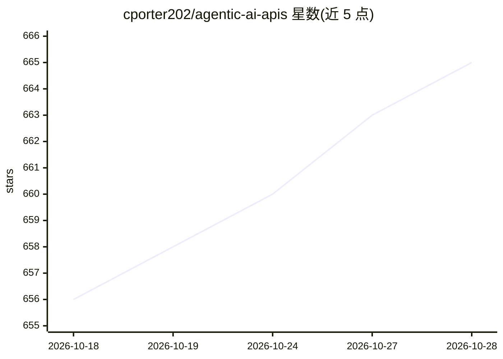

# cporter202/agentic-ai-apis

⭐ 667 · JavaScript · 推送 2026-10-27 · [GitHub](https://github.com/cporter202/agentic-ai-apis) · 个人维护

**面向 AI agent 开发者的 API 策展清单（2,391 条，3 类）**

围绕 agentic AI 基础设施组织的 API 聚合清单：从 Apify 目录每日同步，收录 2,391 个 API，分为 Agents（569，执行/编排/自主任务）、AI Models（1,360，推理/生成/抽取/分析）、MCP Servers（462，MCP 工具集成）三类，每类有独立目录 README。使用方式为浏览条目后跳转至 provider 页面获取定价与文档。GitHub Actions 每日自动同步上游数据，API 链接保留上游的 affiliate 跟踪参数。

## 筛选速览

| 维度 | 判定 | 备注 |
|---|---|---|
| AI 角色 | `ai-knowledge` | 知识聚合/清单类 |
| 许可风险 | `none` | — |
| 部署形态 | `None` |  |
| 模型依赖 | — | README 未给出锁定关系 |
| 硬件要求 | — | 无带数字的原话,不猜 |
| 安装摩擦 | `low` | 无编译、无系统依赖或容器化 |
| 成熟度 | — | 结构信号不足 |

## 能力要点

- 2,391 个 API 按三大类组织，条目经筛选而非全量收录
- Agents / AI Models / MCP Servers 三类均有独立目录
- GitHub Actions 每日同步 Apify 目录并仅在数据变化时提交

## 适用场景

- 搭建自主 agent 前挑选编排与执行类 API
- 查找 MCP 工具集成与 AI 模型服务 API
- 快速构建候选 API 短名单以缩短调研时间

## 场景标签

`精选清单` · 领域:学习与行业

## 证据(README 行号)

> L20: > The ultimate collection of APIs for building autonomous AI agents - **2,391 production-ready APIs** across **Agen
> L22: This repository is designed to feel like a launchpad, not a junk drawer. It is tightly scoped around the API layers
> L121: - A GitHub Actions workflow now syncs the Apify catalog daily and commits only when upstream data actually changes

## 星数曲线

2026-10-18 656 → 2026-10-28 665（+9）

---
*卡片 v1 · prompt 1.4 · 生成 2026-10-22 · 置信度 high · 依据 README sha `84039611f0e0` · [字段定义](../../DATASET.md)*
