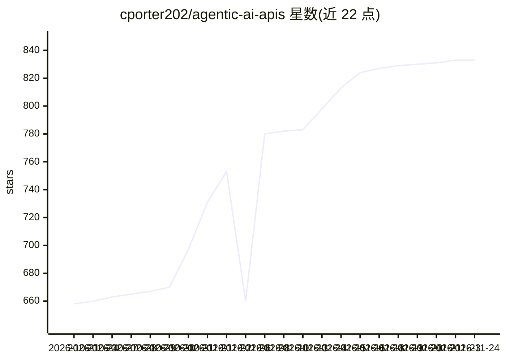

# cporter202/agentic-ai-apis

⭐ 832 · JavaScript · 推送 2026-11-22 · [GitHub](https://github.com/cporter202/agentic-ai-apis) · 个人维护

**给 agent 开发者的 API 目录：聚合 3,077 条 Agents/模型/MCP 条目**

面向构建自主 agent、copilot 与 MCP 工作流的开发者，按 Agents（833）、AI Models（1,761）、MCP Servers（483）三个类别组织的 API 目录清单。用户按层浏览 API 名称与描述，点击跳转到服务商页面查看实现细节、定价与文档。仓库本身不含可运行软件，数据由 GitHub Actions 工作流每日从 Apify 目录同步生成，仅在数据变化时提交；README 声明保留上游链接中的联盟追踪参数。

## 筛选速览

| 维度 | 判定 | 备注 |
|---|---|---|
| AI 角色 | `ai-knowledge` | 知识聚合/清单类 |
| 许可风险 | `none` | — |
| 部署形态 | `None` |  |
| 模型依赖 | — | README 未给出锁定关系 |
| 硬件要求 | — | 无带数字的原话,不猜 |
| 安装摩擦 | `low` | 无编译、无系统依赖或容器化 |
| 成熟度 | — | 结构信号不足 |

## 能力要点

- 按 Agents、AI Models、MCP Servers 三类组织，共 3,077 条 API 目录
- GitHub Actions 每日同步 Apify 目录，数据变化时才提交
- 条目链接指向服务商页面，可查实现、定价与文档

## 适用场景

- 为自主 agent 项目挑选编排与执行类 API 服务商
- 查找可接入助手的 MCP Server 工具集成
- 快速建立 AI Models 服务层的候选清单

## 场景标签

`精选清单` · 领域:学习与行业

## 证据(README 行号)

> L20: > The ultimate collection of APIs for building autonomous AI agents - **3,077 production-ready APIs** across **Agen
> L49: 2. Open that category README and scan the API names and descriptions.
> L121: - A GitHub Actions workflow now syncs the Apify catalog daily and commits only when upstream data actually changes

## 星数曲线

2026-10-21 658 → 2026-11-24 833（+175）

---
*卡片 v1 · prompt 1.4 · 生成 2026-11-24 · 置信度 high · 依据 README sha `170d37e7eec9` · [字段定义](../../DATASET.md)*
