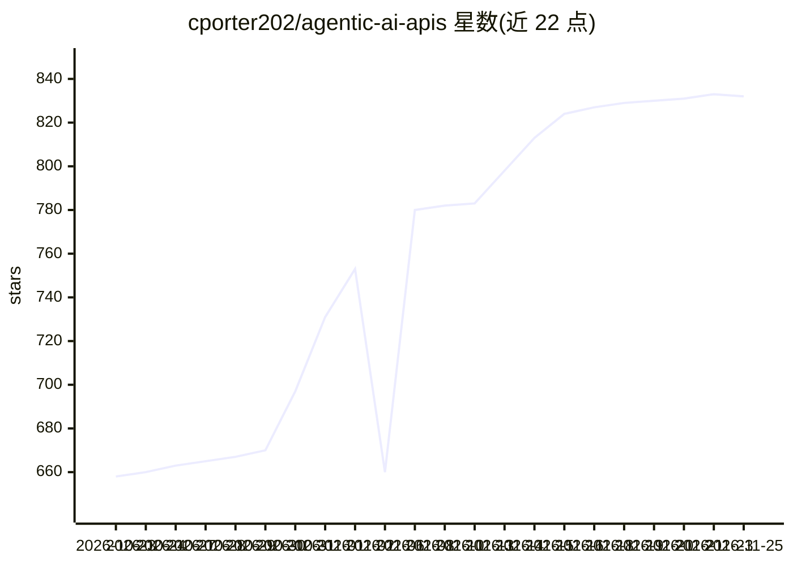

# cporter202/agentic-ai-apis

⭐ 832 · JavaScript · 推送 2026-11-22 · [GitHub](https://github.com/cporter202/agentic-ai-apis) · 个人维护

**给 Agent 开发者的 API 索引清单（2000+ 条，3 类）**

围绕自主 AI 系统构建所需的 API 层编制的目录仓库：按 Agents（826 条）、AI Models（1,563 条）、MCP Servers（475 条）三个类别组织条目，每条链接到服务商页面查看实现细节、定价与文档。通过 GitHub Actions 每日同步 Apify 目录并仅在数据变化时提交，仓库结构仅保留上述三个类别。README 中 API 链接保留上游来源数据的联盟跟踪参数。

## 筛选速览

| 维度 | 判定 | 备注 |
|---|---|---|
| AI 角色 | `ai-knowledge` | 知识聚合/清单类 |
| 许可风险 | `none` | — |
| 部署形态 | `None` |  |
| 模型依赖 | — | README 未给出锁定关系 |
| 硬件要求 | — | 无带数字的原话,不猜 |
| 安装摩擦 | `low` | 无编译、无系统依赖或容器化 |
| 成熟度 | — | 结构信号不足 |

## 能力要点

- 2,864 条 API 按 Agents / AI Models / MCP Servers 三类组织
- MCP Servers 类收录连接外部工具与系统的 Model Context Protocol 集成
- GitHub Actions 每日自动同步 Apify 目录，数据变化时才提交

## 适用场景

- 为自主 Agent 项目快速筛选可接入的 API
- 查找可给助手提供真实世界操作的 MCP 服务器
- 构建 copilot 或工具调用型 LLM 应用前做 API 选型

## 场景标签

`精选清单` · 领域:学习与行业

## 证据(README 行号)

> L20: > The ultimate collection of APIs for building autonomous AI agents - **2,864 production-ready APIs** across **Agen
> L48: 1. Pick the layer you need first: `Agents`, `AI Models`, or `MCP Servers`.
> L107: ## Scope Guarantee

## 星数曲线

2026-10-23 658 → 2026-11-25 832（+174）

---
*卡片 v1 · prompt 1.4 · 生成 2026-11-25 · 置信度 high · 依据 README sha `ba9c4aabded2` · [字段定义](../../DATASET.md)*
