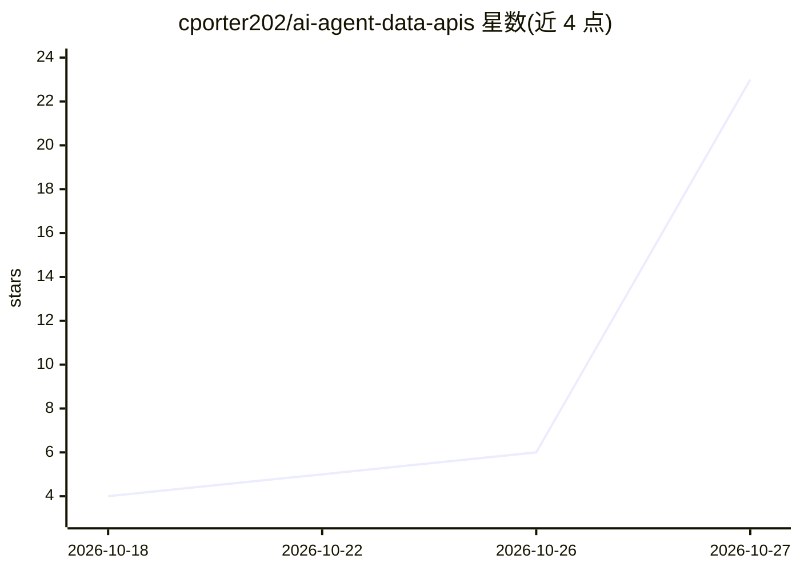

# cporter202/ai-agent-data-apis

⭐ 23 · MIT · 推送 2026-10-20 · [GitHub](https://github.com/cporter202/ai-agent-data-apis) · [官网](https://apify.com?fpr=p2hrc6) · 个人维护

**面向 AI agent 的数据 API 目录：2,070 个 Apify actor 清单**

收录 2,070 个 Apify actor 的目录仓库，按 MCP servers（170）、LLM 工具（120）、RAG（56）、实时网页数据（496）、视觉（252）、语音（107）等类别组织。每个 actor 为可运行的 Apify worker，agent 可经 MCP server 或 API 调用获取实时网页数据，无需自行编写集成代码。面向构建 agent 的开发者，附按任务出发的 playbook 路径。收录条目需经 Apify Store 验证存活后以 PR 加入；仓库含推广/联盟链接。

## 筛选速览

| 维度 | 判定 | 备注 |
|---|---|---|
| AI 角色 | `ai-knowledge` | 知识聚合/清单类 |
| 许可风险 | `permissive` | MIT |
| 部署形态 | `None` |  |
| 模型依赖 | — | README 未给出锁定关系 |
| 硬件要求 | — | 无带数字的原话,不猜 |
| 安装摩擦 | `low` | 无编译、无系统依赖或容器化 |
| 成熟度 | — | 结构信号不足 |

## 能力要点

- 2,070 个验证 actor，覆盖 MCP/LLM/RAG/网页数据/视觉/语音六类
- 经 Apify MCP server 可被 MCP 兼容 agent 直接发现与调用
- 按任务（RAG 知识库、实时数据 agent 等）提供建构路径 playbook
- 条目录入要求附 apify.com 验证 URL 与一行描述

## 适用场景

- 为 Claude/Codex 等 agent 挑选可调用的 MCP server 与数据工具
- 搭建从任意网站抓取到查询的 RAG 流水线
- 给 agent 接入价格监控、网页监测等实时数据源

## 场景标签

`精选清单` · 领域:学习与行业

## 证据(README 行号)

> L25: A mega directory of **2,070 AI agent data APIs** — everything an AI agent needs to touch the live web. MCP servers 
> L38: - 🔍 Browse the actor catalog — 2,070 actors across MCP servers, LLM tools, RAG, live web data, vision, and voice.

## 星数曲线

2026-10-18 4 → 2026-10-27 23（+19）

---
*卡片 v1 · prompt 1.4 · 生成 2026-10-27 · 置信度 high · 依据 README sha `f974bbe42efb` · [字段定义](../../DATASET.md)*
