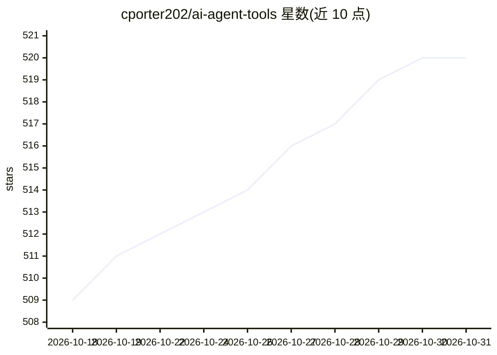

# cporter202/ai-agent-tools

⭐ 520 · 推送 2026-10-20 · [GitHub](https://github.com/cporter202/ai-agent-tools) · [官网](https://viralwavestudio.com) · 个人维护

**面向开发者与创作者的 AI 工具策展清单**

一个人工维护的 AI 工具、实用程序与资源汇总清单：按 AI 文本模型、聊天机器人、写作助手、摘要工具、AI 编程等类别收录条目，每条附名称与一句描述；另设赞助位展示 APIMesa 与 ViralWave Studio 等付费产品。条目以第三方商业产品与开源模型为主，本仓库不提供可安装的软件本体，仅供浏览与查找。

## 筛选速览

| 维度 | 判定 | 备注 |
|---|---|---|
| AI 角色 | `ai-knowledge` | 知识聚合/清单类 |
| 许可风险 | `none` | — |
| 部署形态 | `None` |  |
| 模型依赖 | — | README 未给出锁定关系 |
| 硬件要求 | — | 无带数字的原话,不猜 |
| 安装摩擦 | `low` | 无编译、无系统依赖或容器化 |
| 成熟度 | — | 结构信号不足 |

## 能力要点

- 按模型/聊天机器人/写作助手/摘要/编程等类别组织的策展条目
- 收录 OpenAI API、LLaMA、Bloom 等模型与 ChatGPT、Copilot 等产品条目
- 包含 API 校验与转换类工具条目（OpenAPI 校验、cURL 转换等）

## 适用场景

- 查找各品类的 AI 工具与模型资源
- 了解 AI 文本、编程助手等领域的可用产品范围

## 场景标签

`精选清单` · 领域:学习与行业

## 证据(README 行号)

> L3: > A curated list of Artificial Intelligence Top Tools
> L13: Welcome to AI Agent Tools! This is a curated collection of AI tools, utilities, and resources for developers and cr
> L113: ## Contents

## 星数曲线

2026-10-18 509 → 2026-10-31 520（+11）

---
*卡片 v1 · prompt 1.4 · 生成 2026-10-21 · 置信度 high · 依据 README sha `d02aa1f3763b` · [字段定义](../../DATASET.md)*
