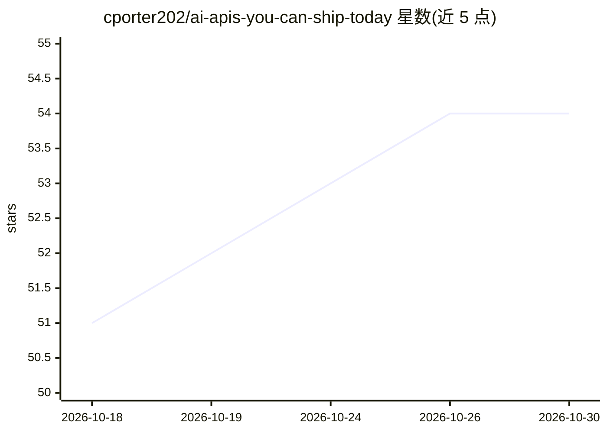

# cporter202/ai-apis-you-can-ship-today

⭐ 54 · 推送 2026-10-20 · [GitHub](https://github.com/cporter202/ai-apis-you-can-ship-today) · 个人维护

**可直接投产的 AI API 目录：1,555 个 API 分 5 类导航**

面向 AI 产品开发者的 API 聚合目录：收录 1,555 个 API，按 LLM 生成与推理（795）、视觉与媒体 AI（83）、Agent 与编排（61）、MCP 服务器（41）、其他 AI 工具（575）五个顶层文件夹组织，每类含独立 README 表格并链接到 provider 页面。分类基于 API 名称与描述的关键词规则，未匹配条目进入 catch-all。README 含作者 Skool 社区与付费订阅推广，且所有链接保留联盟跟踪参数（?fpr=p2hrc6）。仓库本身为纯清单，不提供安装或运行方式。

## 筛选速览

| 维度 | 判定 | 备注 |
|---|---|---|
| AI 角色 | `ai-knowledge` | 知识聚合/清单类 |
| 许可风险 | `none` | — |
| 部署形态 | `None` |  |
| 模型依赖 | — | README 未给出锁定关系 |
| 硬件要求 | — | 无带数字的原话,不猜 |
| 安装摩擦 | `low` | 无编译、无系统依赖或容器化 |
| 成熟度 | — | 结构信号不足 |

## 能力要点

- 1,555 个 API 按五个类别分文件夹组织
- 每个类别含独立 README 目录页与 provider 链接
- 分类基于关键词规则，未匹配条目进入 catch-all 不丢弃
- 链接统一保留联盟跟踪参数

## 适用场景

- 按类别快速筛选可接入产品的 AI API
- 查找 MCP 服务器与 Agent 编排类 API
- 比较 LLM 生成、视觉、OCR 等 API 的覆盖情况

## 场景标签

`精选清单` · 领域:学习与行业

## 证据(README 行号)

> L43: > The ultimate collection of shippable AI APIs — LLMs, vision, agents, and MCP servers ready for production product
> L165: This repository intentionally organizes APIs into:

## 星数曲线

2026-10-18 51 → 2026-10-30 54（+3）

---
*卡片 v1 · prompt 1.4 · 生成 2026-10-24 · 置信度 high · 依据 README sha `13c3d3923152` · [字段定义](../../DATASET.md)*
