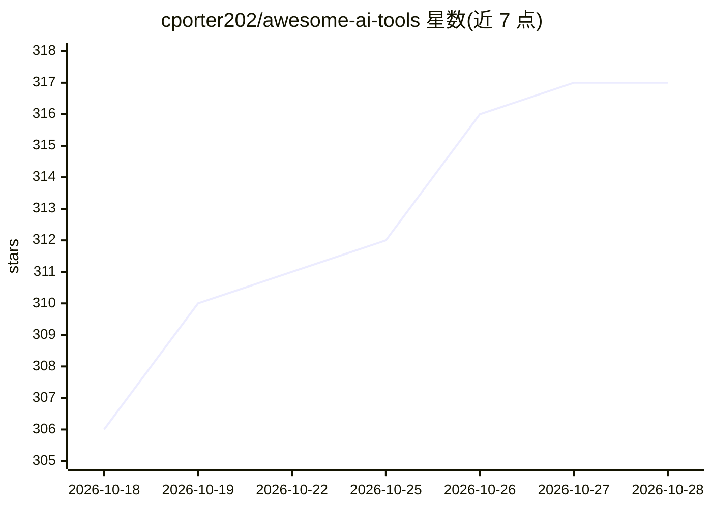

# cporter202/awesome-ai-tools

⭐ 317 · 推送 2026-10-20 · [GitHub](https://github.com/cporter202/awesome-ai-tools) · 个人维护

**16 款精选 AI 工具策展清单：内容、变现、建站、自动化与语音**

由个人维护的 awesome 类工具清单，收录 16 款经实际使用筛选的 AI 工具，覆盖内容与视频创作（ViralWave Studio、Postiz、HeyGen）、变现与电商（Authflow、Printify、EverBee）、AI 建站开发（Lovable、10Web）、自动化与数据（Make.com、Apify、CoreClaw、RSS.app）、交易信号（KamdenAI）与语音通信（ElevenLabs、CallHippo、Chatbase）。置顶推广 APIMesa 按调用计费 API 市场，并声明部分链接含返佣。不提供本产品安装方式。

## 筛选速览

| 维度 | 判定 | 备注 |
|---|---|---|
| AI 角色 | `ai-knowledge` | 知识聚合/清单类 |
| 许可风险 | `none` | — |
| 部署形态 | `None` |  |
| 模型依赖 | — | README 未给出锁定关系 |
| 硬件要求 | — | 无带数字的原话,不猜 |
| 安装摩擦 | `low` | 无编译、无系统依赖或容器化 |
| 成熟度 | — | 结构信号不足 |

## 能力要点

- 16 款按 7 个工作流类别组织的精选工具
- 按'我想做什么'的场景导航表匹配工具
- 每条附工作流说明与适配建议
- 含收录标准说明与工具移除机制

## 适用场景

- 按场景查找内容创作、建站或自动化对应的 AI 工具
- 对比某类别下的候选工具并按工作流选择
- 了解创作者变现与电商方向的工具组合路径

## 场景标签

`精选清单` · 领域:学习与行业

## 证据(README 行号)

> L9:  16 hand-picked tools
> L20: > This is not an exhaustive directory. Every tool here earned its place through real use in projects, workflows, or

## 星数曲线

2026-10-18 306 → 2026-10-28 317（+11）

---
*卡片 v1 · prompt 1.4 · 生成 2026-10-21 · 置信度 high · 依据 README sha `3431c74942b0` · [字段定义](../../DATASET.md)*
