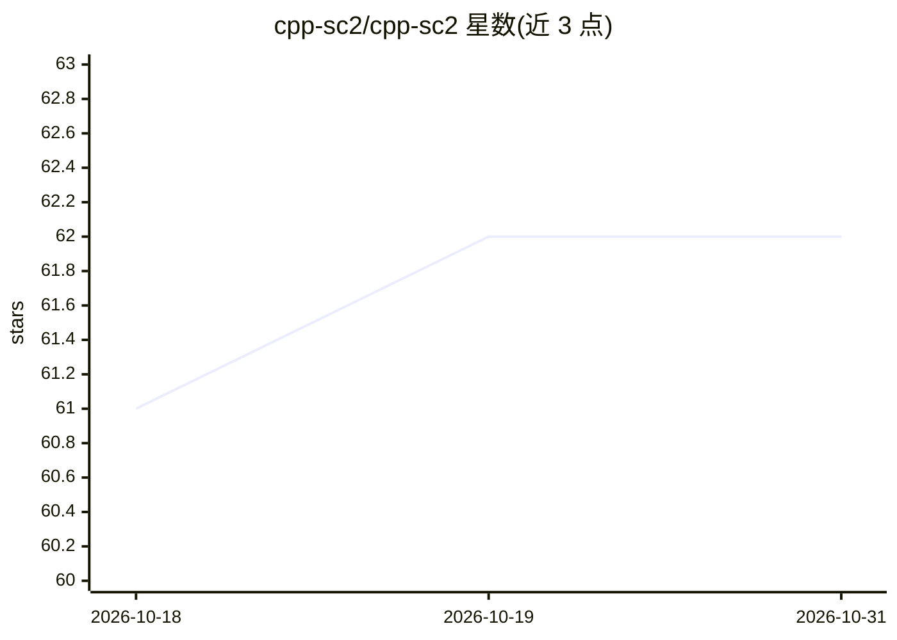

# cpp-sc2/cpp-sc2

⭐ 62 · C++ · MIT · 推送 2026-09-16 · [GitHub](https://github.com/cpp-sc2/cpp-sc2) · 组织维护

**星际争霸 II 的 C++ API 客户端库：读取游戏状态并控制单位**

暴雪 s2client-api 的社区维护 fork，基于 C++20。封装 StarCraft II 的 protobuf/WebSocket 协议，提供类形式的 C++ 抽象，用于获取游戏内状态观测并控制单位，是编写游戏 Bot 的接口库而非 AI 模型本身。依赖 Civetweb、Protobuf（SDL 可选），使用 CMake 构建，配套入门文档、构建指南、Doxygen 生成的 API 文档及示例与模板工程。主要面向用 C++ 开发星际争霸 II AI Bot 的开发者。

## 筛选速览

| 维度 | 判定 | 备注 |
|---|---|---|
| AI 角色 | `ai-ecosystem` | LLM/agent 周边工具 |
| 许可风险 | `permissive` | MIT |
| 部署形态 | `None` |  |
| 模型依赖 | — | README 未给出锁定关系 |
| 硬件要求 | — | 无带数字的原话,不猜 |
| 安装摩擦 | `medium` | 含编译或系统依赖之一 |
| 成熟度 | — | 结构信号不足 |

## 能力要点

- 封装 SC2 protobuf/WebSocket 协议的 C++ 类抽象
- 提供入门教程、构建指南与 Doxygen API 文档
- examples 目录与外部 boilerplate/CommandCenter 等参考实现
- Blizzard/s2client-api 的持续维护 fork

## 适用场景

- 用 C++ 编写星际争霸 II 游戏_bot
- 读取对局状态并下发单位控制指令
- 为 RL/博弈 AI 研究搭建 SC2 环境接口

## 场景标签

 · 领域:游戏 AI/机器人接口

## 证据(README 行号)

> L8: The StarCraft II API provides access to in-game state observation and unit
> L12: While it's possible to write directly to the protocol, this library provides

## 星数曲线

2026-10-18 61 → 2026-10-31 62（+1）

---
*卡片 v1 · prompt 1.4 · 生成 2026-10-24 · 置信度 high · 依据 README sha `5b786a0d8ea1` · [字段定义](../../DATASET.md)*
