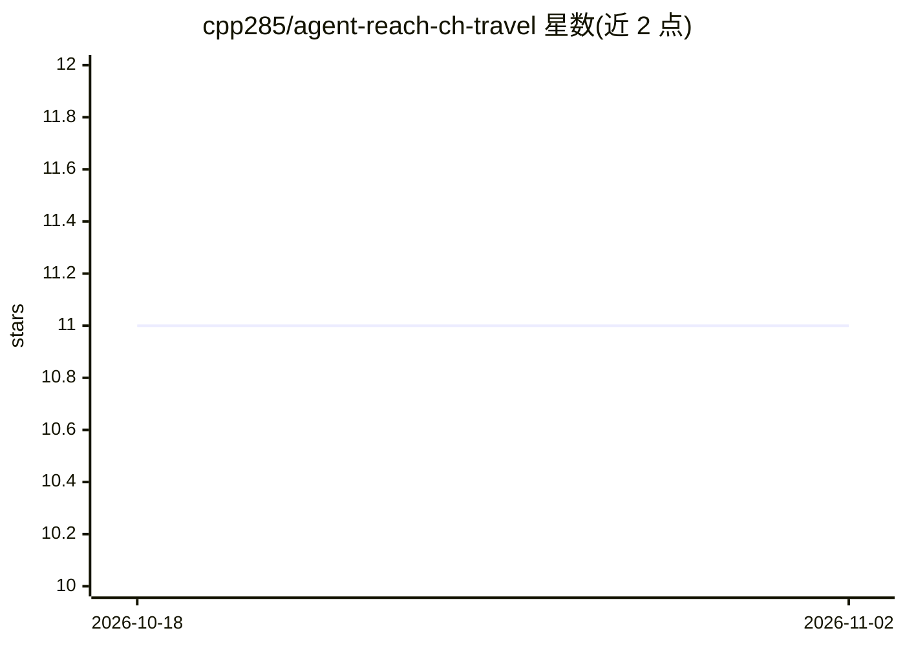

# cpp285/agent-reach-ch-travel

⭐ 11 · Python · MIT · 推送 2026-08-21 · [GitHub](https://github.com/cpp285/agent-reach-ch-travel) · 个人维护 · 中文 README

**国内旅居调研 CLI：聚合房租、天气、设施、B站与 RSS 只读检索**

面向国内旅居、短住和租房调研的 Python 命令行工具，提供 rent/weather/facilities/bili/read/feeds 六个只读命令，覆盖豆瓣租房小组、安居客、贝壳/链家、中国天气网、大众点评、B 站公开搜索 API、Jina Reader 与 RSS/Atom。不要求平台账号或 Cookie，某来源失败时其余来源继续处理并标注 [失败]。附 Python API 与 SKILL.md，可供 AI Agent 作为技能调用。限制：反爬较强的站点可能返回验证页，B 站接口非正式开放 API。

## 筛选速览

| 维度 | 判定 | 备注 |
|---|---|---|
| AI 角色 | `ai-ecosystem` | LLM/agent 周边工具 |
| 许可风险 | `permissive` | MIT |
| 部署形态 | `library` | 以包/库形式分发 |
| 模型依赖 | — | README 未给出锁定关系 |
| 硬件要求 | — | 无带数字的原话,不猜 |
| 安装摩擦 | `low` | 无编译、无系统依赖或容器化 |
| 成熟度 | — | 结构信号不足 |

## 能力要点

- 六类只读命令覆盖房租/天气/设施/B站体验/网页/RSS
- 无需账号或 Cookie，仅读取公开网页与公开接口
- 单来源失败自动降级（如 bili-cli 降级到公开 API，Jina Reader 降级直连）
- 提供 SKILL.md 定义 Agent 触发场景与降级策略

## 适用场景

- 旅居前调研目标城市的房租与常见片区
- 查询城市 7 天天气预报与周边生活设施
- 通过 B 站实地视频与 RSS 资讯补充本地信息

## 场景标签

`网页抓取` · 领域:效率与自动化

## 证据(README 行号)

> L103: 仓库中的 `SKILL.md` 定义了适合 AI Agent 的触发场景、检索顺序和失败降级策略。安装本包后，Agent 可以调用相同的 `ch-travel` 命令。
> L3: 一个面向国内旅居、短住和租房调研的轻量 Python 工具。它把房租、天气、周边设施、B 站实地体验和 RSS 资讯整理成统一的命令行与 Python API。

## 星数曲线

2026-10-18 11 → 2026-11-02 11（+0）

---
*卡片 v1 · prompt 1.4 · 生成 2026-11-02 · 置信度 low · 依据 README sha `ba25247f852a` · [字段定义](../../DATASET.md)*
