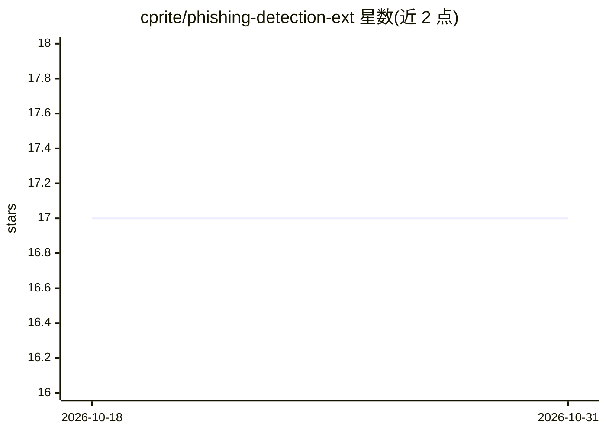

# cprite/phishing-detection-ext

⭐ 17 · Jupyter Notebook · GPL-2.0 · 推送 2026-07-22 · [GitHub](https://github.com/cprite/phishing-detection-ext) · 个人维护

**本地 Chrome 扩展：KNN 实时检测钓鱼 URL 并拦截**

自包含的 Chrome 扩展，在浏览器本地对访问页面进行钓鱼 URL 检测：分类器为纯 JavaScript 实现的 K-Nearest-Neighbours（k=3, manhattan 距离），基于 11 个浏览器可计算特征，测试集准确率 89.42%，无服务器、无 ONNX、无 WebAssembly、数据不出设备。KNN 为实例学习方法，用户标记的正确/误报会作为新数据点立即影响后续预测（此自学习功能仅开源构建版包含，Chrome Web Store 版被移除）。另含基于规则的仿冒域名检测器（约 50 个品牌、同形字/typosquat 等四类检测）。提供 git clone 加载未打包扩展的安装方式，可选 Python 脚本重建种子模型。开发者自述非认证网络安全专业人员，工具定位为辅助。

## 筛选速览

| 维度 | 判定 | 备注 |
|---|---|---|
| AI 角色 | `ai-native` | 本体是模型或模型工具 |
| 许可风险 | `viral` | GPL-2.0 |
| 部署形态 | `library` | 以包/库形式分发 |
| 模型依赖 | — | README 未给出锁定关系 |
| 硬件要求 | — | 无带数字的原话,不猜 |
| 安装摩擦 | `low` | 无编译、无系统依赖或容器化 |
| 成熟度 | — | 结构信号不足 |

## 能力要点

- 纯 JavaScript KNN 分类器（k=3, manhattan），11 个浏览器端特征，89.42% 测试准确率
- 全部本地运行：无服务器、无网络调用、数据不离开设备
- 实例学习式自学习：用户纠正即时生效（仅开源构建版）
- 仿冒域名规则检测器：子域名注入/同形字/typosquat/TLD 欺骗四类规则

## 适用场景

- 浏览时自动拦截钓鱼页面并跳转警告页
- 对我误报的站点一键放行并作为纠正样本
- 检查域名是否为品牌仿冒（同形字/typosquat）

## 场景标签

`网络安全` · 领域:学习与行业

## 证据(README 行号)

> L33: **No Phishing** is a self-contained Chrome extension that detects phishing URLs in real time. The classifier is a *
> L97: **KNN classifier** (`extension/knn.js`) — a pure-JS port of scikit-learn's `KNeighborsClassifier(n_neighbors=3, met

## 星数曲线

2026-10-18 17 → 2026-10-31 17（+0）

---
*卡片 v1 · prompt 1.4 · 生成 2026-10-29 · 置信度 mid · 依据 README sha `d16722855771` · [字段定义](../../DATASET.md)*
