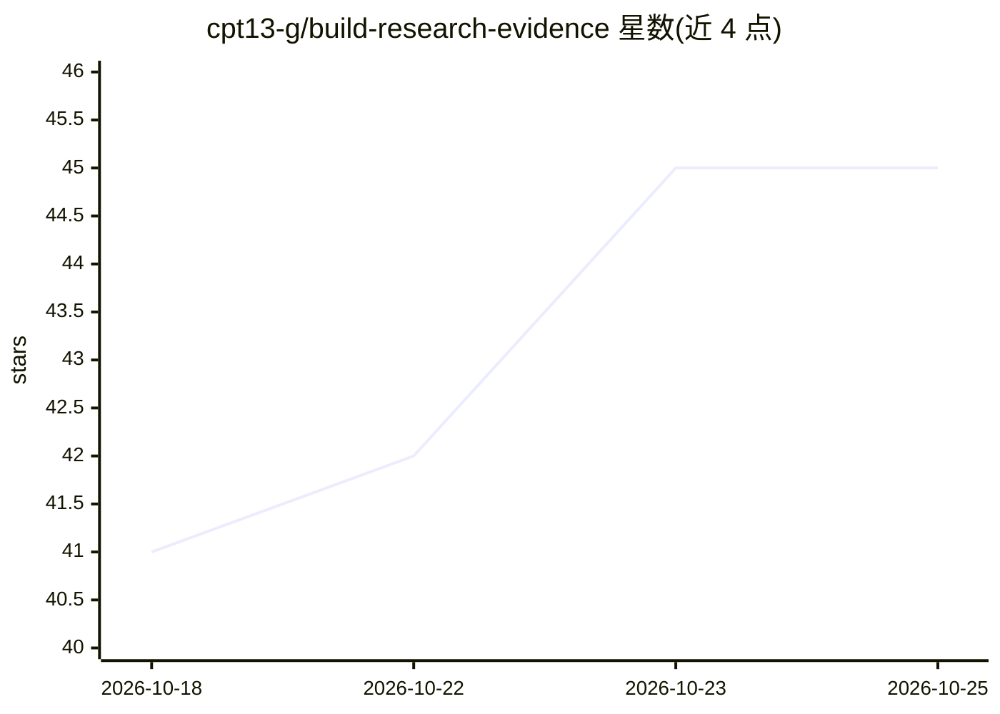

# cpt13-g/build-research-evidence

⭐ 46 · Python · Apache-2.0 · 推送 2026-10-21 · [GitHub](https://github.com/cpt13-g/build-research-evidence) · 个人维护 · 中文 README

**面向 AI/CS 科研的长线实验智能体：把 Idea 转成可追溯证据**

由四个职责分离的 Codex Skill（编排、执行、审计、投稿证据检查）加共享项目状态与实验记忆组成的科研实验工作流：承接已有 Research Idea，转成可检验 Claim 与骨干实验优先级，P0 实验先行、按 Claim–Evidence Matrix 补充消融与稳健性，每轮结果由独立 Auditor 检查公平性与混杂因素，最终经 Gate 3 冻结证据。设置三个 Human Gate 保留人工决策权。通过 git clone 源码安装，在 Codex 中加载使用。

## 筛选速览

| 维度 | 判定 | 备注 |
|---|---|---|
| AI 角色 | `ai-native` | 本体是模型或模型工具 |
| 许可风险 | `permissive` | Apache-2.0 |
| 部署形态 | `library` | 以包/库形式分发 |
| 模型依赖 | — | README 未给出锁定关系 |
| 硬件要求 | — | 无带数字的原话,不猜 |
| 安装摩擦 | `low` | 无编译、无系统依赖或容器化 |
| 成熟度 | — | 结构信号不足 |

## 能力要点

- 四个 Skill 分工：orchestrator 决策、runner 执行、auditor 独立审计、venue-evidence-audit 查投稿缺口
- Claim 驱动与 P0 骨干实验优先，无关扩展进入 Backlog
- Experiment Card、Run Manifest 与原始证据可校验记录，Evidence Freeze 冻结项目
- 三个 Human Gate 保留研究者对主线、预算与最终证据的控制

## 适用场景

- 已有论文 Idea，需要拆解成有先后关系的实验并长线推进
- 实验越做越散、调参难以收尾时收束研究主线
- 需要复盘方法演化、失败原因与结论依据并生成投稿证据矩阵

## 场景标签

`科研工具` `Agent 框架` · 领域:Agent 开发

## 证据(README 行号)

> L5: 面向计算机科学、人工智能与数据驱动工科论文的**长线科研实验智能体**。它承接已经明确的 Research Idea，把方法设计、代码实现、实验执行、结果审计和投稿证据补全连接成一条可恢复、可约束、可停止的工作流。
> L32: 项目由四个职责分离的 Skill、统一项目状态和实验记忆共同组成。总控掌握科研决策，专业 Skill 分别负责执行、审计与投稿证据检查，彼此交接、互相约束。
> L96: 在 Codex 中打开仓库根目录。项目级 `AGENTS.md` 与 `.agents/skills/` 会随仓库加载；可以先用 `/skills` 确认四个 Skill 已出现，然后发送：

## 星数曲线

2026-10-18 41 → 2026-10-25 45（+4）

---
*卡片 v1 · prompt 1.4 · 生成 2026-10-25 · 置信度 mid · 依据 README sha `a5d65306ff8c` · [字段定义](../../DATASET.md)*
