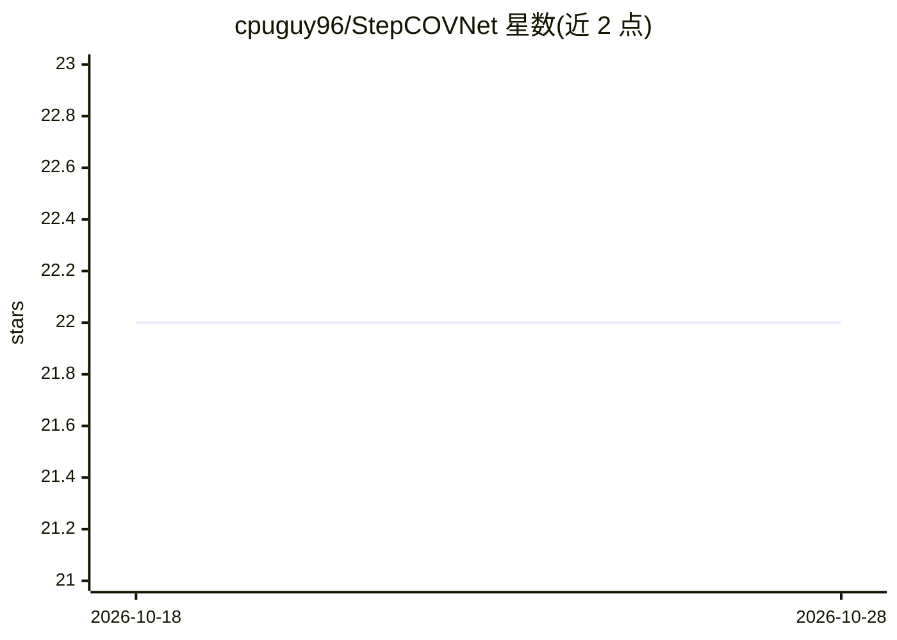

# cpuguy96/StepCOVNet

⭐ 22 · Python · Apache-2.0 · 推送 2026-10-11 · [GitHub](https://github.com/cpuguy96/StepCOVNet) · 个人维护

**用深度学习从音频自动生成 StepMania 谱面的工具**

面向节奏游戏玩家的深度学习项目：用 CNN 与 Transformer 从音频文件检测音符 onset 并预测方向键（上下左右）排列，生成 StepMania 谱面；输出为 .txt 文件，需借助 SMDataTools 转成 .sm。提供命令行脚本与桌面 UI，预训练模型可从 Google Drive 自动下载并缓存；也提供用自有数据训练 onset 与 arrow 模型的脚本。Windows 有预构建可执行文件，GPU 训练在 Windows 下经 WSL 自动分发。

## 筛选速览

| 维度 | 判定 | 备注 |
|---|---|---|
| AI 角色 | `ai-native` | 本体是模型或模型工具 |
| 许可风险 | `permissive` | Apache-2.0 |
| 部署形态 | `desktop` | 安装包/桌面程序 |
| 模型依赖 | — | README 未给出锁定关系 |
| 硬件要求 | — | 无带数字的原话,不猜 |
| 安装摩擦 | `low` | 无编译、无系统依赖或容器化 |
| 成熟度 | — | 结构信号不足 |

## 能力要点

- CNN + Transformer 检测 onset 并预测箭头排列
- 预训练模型可从 Google Drive 自动下载缓存
- 提供桌面 Generator UI 与预构建 Windows 可执行文件
- 含数据预处理与 onset/arrow 模型训练脚本

## 适用场景

- 给自己喜欢的歌曲快速生成 StepMania 谱面
- 用自己的谱面数据训练定制模型
- 不装 Python 直接运行预构建的桌面 UI

## 场景标签

 · 领域:游戏/音乐 AI

## 证据(README 行号)

> L15: **StepCOVNet** is a deep learning project designed to automatically generate StepMania charts from audio files. It
> L16: utilizes Convolutional Neural Networks (CNNs) and Transformers to detect note onsets and predict arrow patterns,

## 星数曲线

2026-10-18 22 → 2026-10-28 22（+0）

---
*卡片 v1 · prompt 1.4 · 生成 2026-10-27 · 置信度 high · 依据 README sha `9ca409c9305d` · [字段定义](../../DATASET.md)*
