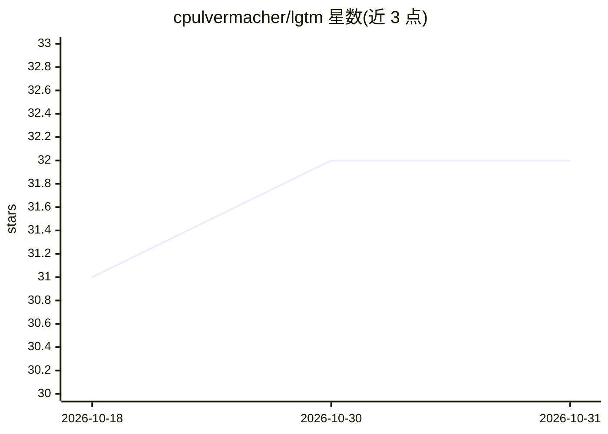

# cpulvermacher/lgtm

⭐ 32 · TypeScript · MIT · 推送 2026-10-22 · [GitHub](https://github.com/cpulvermacher/lgtm) · [官网](https://marketplace.visualstudio.com/items?itemName=cpulvermacher.lgtm) · 个人维护

**VS Code 扩展：用 Copilot Chat 审查 PR 与 git 改动**

面向 VS Code 用户的代码审查扩展，调用 GitHub Copilot Chat 对 pull request 或 git 源码改动进行审查，在 Chat 侧边栏输出按文件分组、按严重度排序的评论，点击行号可跳转位置。支持 GitHub Pull Requests 与 Bitbucket 扩展的 PR 集成、/review 聊天命令、agent 模式下的 #review/#reviewStaged/#reviewUnstaged 工具、评论自动 Fix、AGENTS.md 上下文与自定义指令。默认只需 Copilot（免费与付费计划均可），也可选择 VS Code 可用的其他语言模型；限制包括不支持部分模型、大改动集可能触发限流，审查内容会发送至所配置的模型/提供方。

## 筛选速览

| 维度 | 判定 | 备注 |
|---|---|---|
| AI 角色 | `ai-native` | 本体是模型或模型工具 |
| 许可风险 | `permissive` | MIT |
| 部署形态 | `None` |  |
| 模型依赖 | — | README 未给出锁定关系 |
| 硬件要求 | — | 无带数字的原话,不猜 |
| 安装摩擦 | `low` | 无编译、无系统依赖或容器化 |
| 成熟度 | — | 结构信号不足 |

## 能力要点

- 调用 Copilot Chat 审查 PR 与 git 改动，输出按严重度排序的评论
- agent 模式下提供 #review/#reviewStaged/#reviewUnstaged 工具
- 支持评论自动 Fix 与自定义指令、AGENTS.md 上下文
- 提供可编程调用的 lgtm.reviewChanges 命令与共享类型定义

## 适用场景

- 合并前自动审查我的 PR 或本地改动
- 让 agent 在改完代码后自动跑审查并修复严重问题
- 对 staged/unstaged 改动做定点检查

## 场景标签

`代码审查` · 领域:编码与开发

## 证据(README 行号)

> L6: Use GitHub Copilot Chat to review pull requests or source code changes in Git, and catch bugs, areas for improvement
> L51: - **Only Copilot Required**: Defaults to using Copilot Chat for reviewing changes. Both free and paid plans are sup

## 星数曲线

2026-10-18 31 → 2026-10-31 32（+1）

---
*卡片 v1 · prompt 1.4 · 生成 2026-10-26 · 置信度 high · 依据 README sha `508080eac0d0` · [字段定义](../../DATASET.md)*
