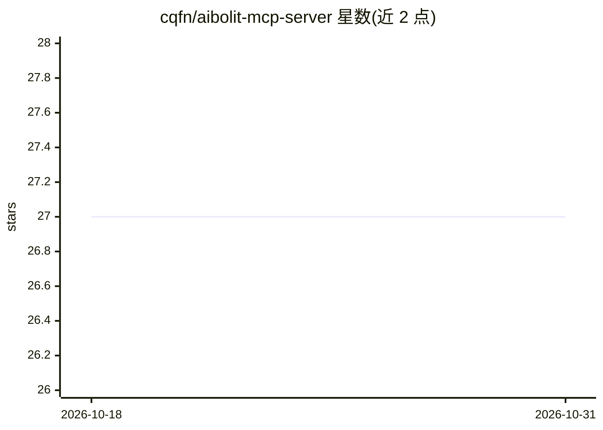

# cqfn/aibolit-mcp-server

⭐ 27 · TypeScript · MIT · 推送 2026-04-07 · [GitHub](https://github.com/cqfn/aibolit-mcp-server) · [官网](https://www.npmjs.com/package/aibolit-mcp-server) · 组织维护

**把 Aibolit Java 静态分析接入 AI Agent 的 MCP 服务器**

为 Aibolit Java 静态分析器提供 MCP 服务器封装：通过 MCP 协议向 Claude Code、Cursor、Windsurf 等 AI agent 暴露分析能力，帮助 agent 识别代码中最关键的设计问题并据此重构，而非只处理表层小问题。安装需先具备 Node、Npm、Python、Pip 与 aibolit 本体，再以 npx 方式将 MCP 服务器注册进 Claude Code（claude mcp add）。贡献流程要求 Node 18+、Npm 与 GNU make。

## 筛选速览

| 维度 | 判定 | 备注 |
|---|---|---|
| AI 角色 | `ai-ecosystem` | LLM/agent 周边工具 |
| 许可风险 | `permissive` | MIT |
| 部署形态 | `library` | 以包/库形式分发 |
| 模型依赖 | locked-api |  |
| 硬件要求 | — | 无带数字的原话,不猜 |
| 安装摩擦 | `low` | 无编译、无系统依赖或容器化 |
| 成熟度 | — | 结构信号不足 |

## 能力要点

- 通过 MCP 协议向 AI agent 暴露 Aibolit 静态分析能力
- 为 agent 提示代码中最关键的设计问题以引导重构
- 支持以 claude mcp add 一行命令注册进 Claude Code

## 适用场景

- 让 Claude Code 等 agent 在重构前先定位最关键的设计问题
- 在 Java 项目中以 AI agent 辅助代码质量改进

## 场景标签

`编码 Agent` · 领域:编码与开发

## 证据(README 行号)

> L11:  for code refactoring, you may enjoy using this [MCP] server.
> L17: This [MCP] server will give your agent a hint:

## 星数曲线

2026-10-18 27 → 2026-10-31 27（+0）

---
*卡片 v1 · prompt 1.4 · 生成 2026-10-26 · 置信度 high · 依据 README sha `72053c8646d9` · [字段定义](../../DATASET.md)*
