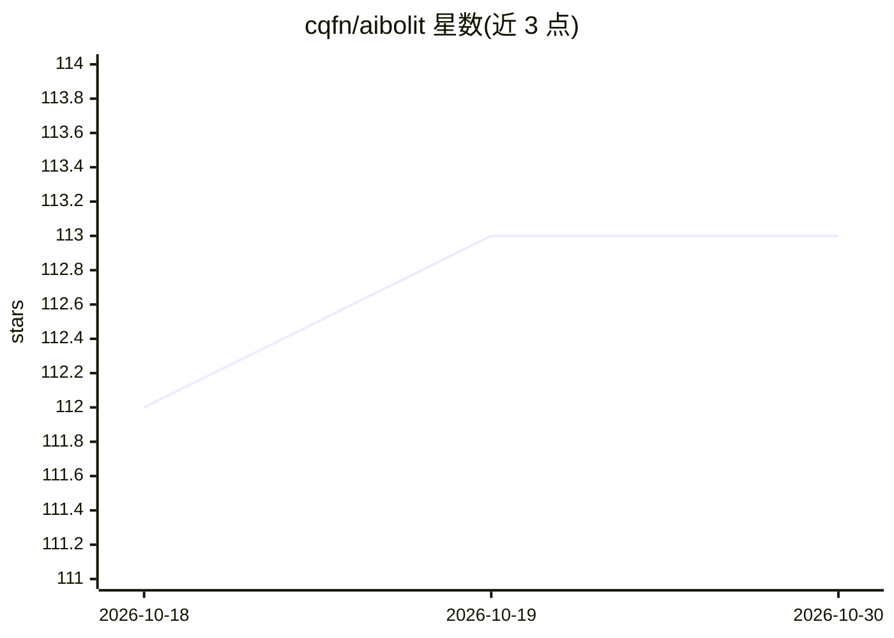

# cqfn/aibolit

⭐ 113 · Java · MIT · 推送 2026-10-28 · [GitHub](https://github.com/cqfn/aibolit) · [官网](https://pypi.org/project/aibolit/) · 组织维护

**面向 Java 的机器学习静态分析器：定位最需重构的反模式**

Aibolit 是一个用 Python 编写的 Java 静态分析工具：读取 Java 源码文件或目录，基于内置机器学习模型（model.pkl，随 pip 包自动安装）计算各类反模式（pattern）对圈复杂度（Cyclomatic Complexity）的贡献，按重要性分数排序输出重构建议，支持抑制指定模式、glob 排除文件与 compact/long/xml 输出格式，退出码区分无问题/有问题/崩溃三种情况。同时提供 train 命令与 Docker 镜像，可用自有 Java 代码集重建数据集并重训模型，也支持替换自定义模型文件。供需要量化代码质量与重构优先级的 Java 开发者使用。限制：要求 Python 3.11+，贡献构建另需 Ruby、Maven、LaTeX 等工具链。

## 筛选速览

| 维度 | 判定 | 备注 |
|---|---|---|
| AI 角色 | `ai-native` | 本体是模型或模型工具 |
| 许可风险 | `permissive` | MIT |
| 部署形态 | `self-host` | docker 或自建部署 |
| 模型依赖 | — | README 未给出锁定关系 |
| 硬件要求 | — | 无带数字的原话,不猜 |
| 安装摩擦 | `low` | 无编译、无系统依赖或容器化 |
| 成熟度 | — | 结构信号不足 |

## 能力要点

- 内置 ML 模型按反模式对圈复杂度的贡献度排序重构建议
- 支持 --suppress 抑制模式、--exclude glob 排除文件、compact/long/xml 多种输出格式
- train 命令与 Docker 镜像支持用自有数据集重训模型，可替换自定义 model.pkl
- 退出码语义明确：0 无问题 / 1 有问题 / 2 程序崩溃，便于 CI 集成

## 适用场景

- 在 CI 中检查 Java 代码是否存在反模式并按退出码阻断构建
- 量化多个项目的代码可维护性分数并做横向对比
- 用自己的 Java 代码集重训模型以适配团队代码风格

## 场景标签

 · 领域:软件开发/代码质量

## 证据(README 行号)

> L1: # ML-Based Static Analyzer for Java
> L45: It will run recommendation function for the model (model is located in
> L47: The model finds a pattern which contribution is the largest to the

## 星数曲线

2026-10-18 112 → 2026-10-30 113（+1）

---
*卡片 v1 · prompt 1.4 · 生成 2026-10-23 · 置信度 high · 依据 README sha `9da92748163a` · [字段定义](../../DATASET.md)*
