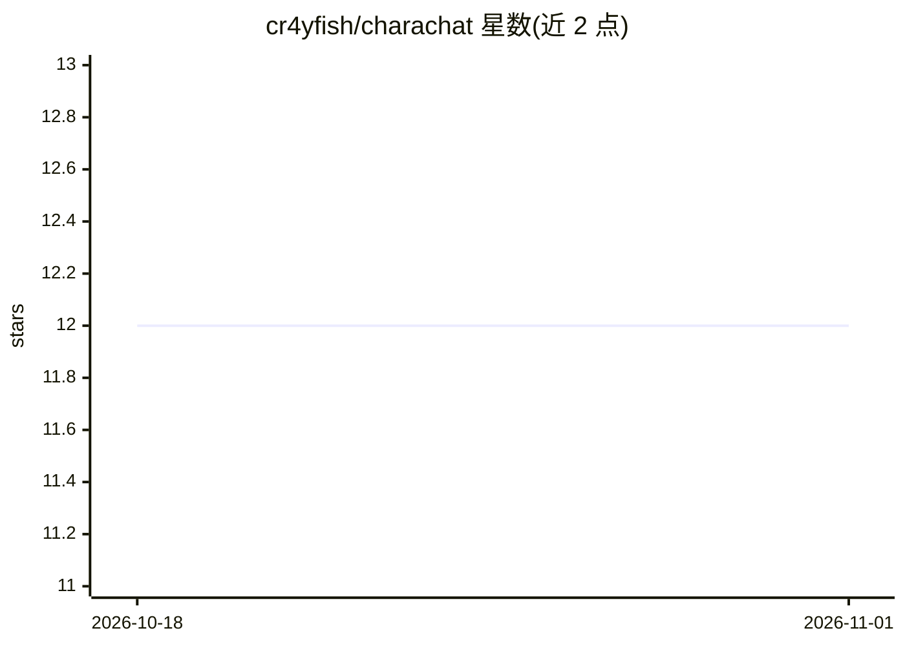

# cr4yfish/charachat

⭐ 12 · TypeScript · AGPL-3.0 · 推送 2025-12-04 · [GitHub](https://github.com/cr4yfish/charachat) · [官网](https://charachat.app) · 个人维护

**支持多 LLM 的私密 AI 角色对话 Web 应用**

基于 Next.js/Supabase/Vercel AI SDK 构建的角色对话 Web 应用：用户可创建或导入角色（支持从动漫、维基百科、Silly Tavern 等来源导入），与具备个性和长期记忆的角色聊天，支持故事创作与基于故事的对话。支持 OpenAI、Mistral、Ollama、Gemini、Claude 等 LLM，用户自带 API key。消息在数据库中加密存储、由客户端用密码派生密钥解密；模型推理时消息以明文流经 HTTPS 通道。使用需通过 webapp 注册并配置 API key。

## 筛选速览

| 维度 | 判定 | 备注 |
|---|---|---|
| AI 角色 | `ai-native` | 本体是模型或模型工具 |
| 许可风险 | `viral` | AGPL-3.0 |
| 部署形态 | `None` |  |
| 模型依赖 | local-ok | 支持本地模型 |
| 硬件要求 | — | 无带数字的原话,不猜 |
| 安装摩擦 | `low` | 无编译、无系统依赖或容器化 |
| 成熟度 | — | 结构信号不足 |

## 能力要点

- 支持 OpenAI/Mistral/Ollama/Gemini/Claude 多种 LLM，用户自带 API key
- 消息数据库加密存储，客户端用密码派生密钥解密
- 角色导入：动漫、维基百科、Fandom、Silly Tavern 等
- 带记忆 Agent 与角色/用户数据访问的 Agent 结构

## 适用场景

- 与自建或导入的角色进行个性化对话
- 创作故事并基于故事开启对话
- 在不信任服务端的前提下进行私密角色聊天

## 场景标签

`聊天机器人` · 领域:对话与助手

## 证据(README 行号)

> L9: Lets you create a character or use a pre-made one and chat with them. The character will respond to you based on the
> L33: - [x] LLMs

## 星数曲线

2026-10-18 12 → 2026-11-01 12（+0）

---
*卡片 v1 · prompt 1.4 · 生成 2026-11-01 · 置信度 high · 依据 README sha `7dc90a100f46` · [字段定义](../../DATASET.md)*
