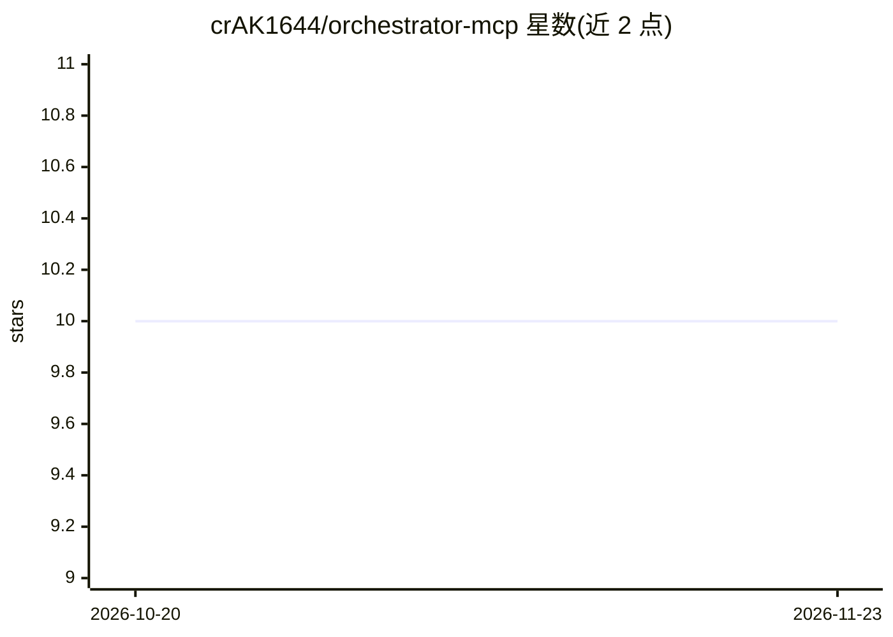

# crAK1644/orchestrator-mcp

⭐ 10 · Python · MIT · 推送 2026-10-18 · [GitHub](https://github.com/crAK1644/orchestrator-mcp) · [官网](https://pypi.org/project/orchestrator-mcp-server/) · 个人维护

**MCP 服务器：让一个编码 Agent CLI 咨询另一个已登录的 Agent**

本地 Model Context Protocol 服务器，启动机器上已安装并登录的 Codex、Claude Code、OpenCode、GitHub Copilot 或 Antigravity CLI，将请求路由给对方并返回结构化回答。复用各厂商 CLI 已有订阅登录，不要求 provider API key，凭据不离开各 CLI。支持多轮咨询（consultation_id 续接）、多厂商评审面板并行评审、一次性 worktree 中的委托编辑，每次咨询记录入本地 SQLite 数据库并提供本地仪表盘与终端报表查看用量、成本与得分。

## 筛选速览

| 维度 | 判定 | 备注 |
|---|---|---|
| AI 角色 | `ai-ecosystem` | LLM/agent 周边工具 |
| 许可风险 | `permissive` | MIT |
| 部署形态 | `library` | 以包/库形式分发 |
| 模型依赖 | — | README 未给出锁定关系 |
| 硬件要求 | — | 无带数字的原话,不猜 |
| 安装摩擦 | `low` | 无编译、无系统依赖或容器化 |
| 成熟度 | — | 结构信号不足 |

## 能力要点

- 复用已有订阅登录，无需配置 provider API key
- 多轮咨询：通过 consultation_id 在同一客户端续接对话
- 多厂商评审面板并行作答后综合，禁止路由回宿主自身运行时
- 每次咨询写入本地数据库，附仪表盘与六类只读终端报表

## 适用场景

- 在 Claude Code 中向 Codex 请求第二意见而无需切换窗口
- 让不同厂商的多个 Agent 并行评审代码后取综合结论
- 审计各 Agent 的咨询历史、token 用量与成本

## 场景标签

`编码 Agent` `多智能体` · 领域:Agent 开发

## 证据(README 行号)

> L24: Orchestrator MCP is a local Model Context Protocol server that lets one coding agent consult another. It launches t
> L26: It does not ask for a provider key, proxy provider traffic, or silently switch models. Authentication remains insid

## 星数曲线

2026-10-20 10 → 2026-11-23 10（+0）

---
*卡片 v1 · prompt 1.4 · 生成 2026-11-19 · 置信度 high · 依据 README sha `7d7e110c03c9` · [字段定义](../../DATASET.md)*
