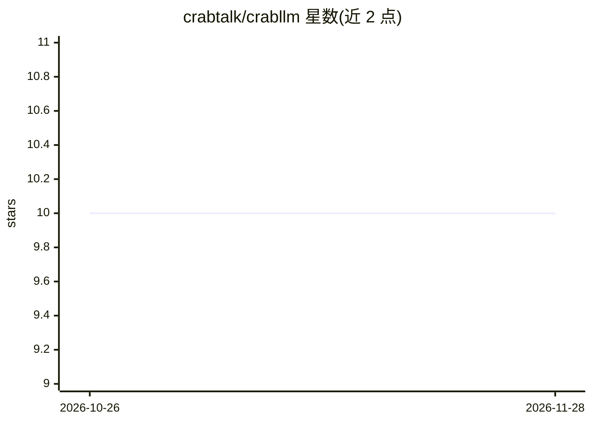

# crabtalk/crabllm

⭐ 10 · Rust · MIT · 推送 2026-09-16 · [GitHub](https://github.com/crabtalk/crabllm) · [官网](https://crabtalk.ai/crabllm) · 组织维护

**面向开发者的 Rust LLM API 网关：统一格式接入多家模型商**

用 Rust 编写的 LLM API 网关，部署在应用与模型服务之间：对外暴露 OpenAI 兼容 API，按配置将请求路由到 OpenAI、Anthropic、Azure、Ollama 及任何 OpenAI 兼容服务。首启生成 crabllm.toml 配置与管理令牌，通过 crabctl 命令行增删 provider 且无需重启；README 附带与 bifrost、litellm 的代理开销与内存对比基准，提供 crates.io 安装与 Docker 镜像两种部署方式，采用 MIT OR Apache-2.0 双许可。

## 筛选速览

| 维度 | 判定 | 备注 |
|---|---|---|
| AI 角色 | `ai-ecosystem` | LLM/agent 周边工具 |
| 许可风险 | `permissive` | MIT |
| 部署形态 | `library` | 以包/库形式分发 |
| 模型依赖 | local-ok | 支持本地模型 |
| 硬件要求 | — | 无带数字的原话,不猜 |
| 安装摩擦 | `low` | 无编译、无系统依赖或容器化 |
| 成熟度 | — | 结构信号不足 |

## 能力要点

- 暴露 OpenAI 兼容 API，路由到 OpenAI/Anthropic/Azure/Ollama 等多家 provider
- crabctl 命令行动态管理 provider，无需重启
- 自动从 provider 的 /models 端点拉取模型列表
- 提供 Docker 镜像与基准测试工具（make bench 等）

## 适用场景

- 统一一个 API 格式接入多家 LLM provider
- 在应用与模型服务之间做请求路由与日志
- 自托管网关并动态增删上游 provider

## 场景标签

`模型网关` · 领域:Agent 开发

## 证据(README 行号)

> L9: Crabllm sits between your application and LLM providers. It exposes an OpenAI-compatible API and routes requests to 
> L10: configured provider — OpenAI, Anthropic, Azure, Ollama, and any OpenAI-compatible service.

## 星数曲线

2026-10-26 10 → 2026-11-28 10（+0）

---
*卡片 v1 · prompt 1.4 · 生成 2026-11-19 · 置信度 high · 依据 README sha `ddf9a2ed26f4` · [字段定义](../../DATASET.md)*
