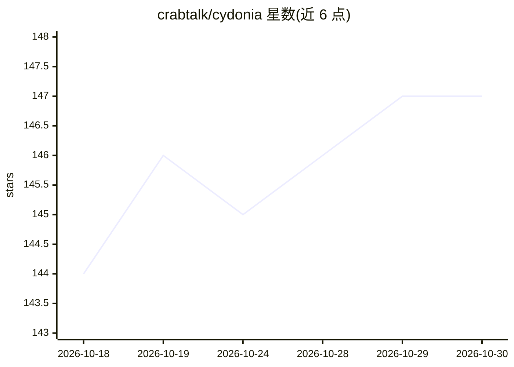

# crabtalk/cydonia

⭐ 147 · Rust · MIT · 推送 2026-10-29 · [GitHub](https://github.com/crabtalk/cydonia) · [官网](https://cydonia.sh) · 组织维护

**管理 40+ 编码 agent 的本地优先桌面工作台**

基于 GPUI 的桌面应用，面向运行编码 agent 的开发者：把目录作为项目打开，接入任何支持 ACP 协议的 agent（Claude Code、Codex、OpenCode、Pi 等 40+），将产出以文章、看板、表格等持久工件形式存于磁盘而非聊天记录。agent 可从 ACP 注册表安装或通过 settings.toml 手动配置；外部 MCP agent 可通过 project_entries/project_read_entry 读取条目。数据存储于本机目录，项目 store 自带 .gitignore。通过 cargo install 安装，MIT 许可。

## 筛选速览

| 维度 | 判定 | 备注 |
|---|---|---|
| AI 角色 | `ai-ecosystem` | LLM/agent 周边工具 |
| 许可风险 | `permissive` | MIT |
| 部署形态 | `library` | 以包/库形式分发 |
| 模型依赖 | — | README 未给出锁定关系 |
| 硬件要求 | — | 无带数字的原话,不猜 |
| 安装摩擦 | `low` | 无编译、无系统依赖或容器化 |
| 成熟度 | `idea` | |

## 能力要点

- 通过 ACP 协议接入 Claude Code、Codex、OpenCode、Pi 等 40+ agent
- 产出以文章、看板、表格等持久工件形式落盘，非聊天日志
- 支持外部 MCP agent 通过 project_entries/project_read_entry 读取条目
- 数据存放于本机 ~/.config 与项目 .cydonia 目录，本地优先

## 适用场景

- 在一个桌面工作台里统一管理多个编码 agent 会话
- 把 agent 的产出整理为文章和看板等可持久保存的工件
- 让 MCP agent 读取项目内的条目与表格数据

## 场景标签

`编码 Agent` · 领域:编码与开发

## 证据(README 行号)

> L7: A desktop workspace for the coding agents you run. Open a directory as a
> L8: project, put any agent that speaks ACP to work
> L40: Install one from the ACP registry in **Settings › Agents**, or write it into

## 星数曲线

2026-10-18 144 → 2026-10-30 147（+3）

---
*卡片 v1 · prompt 1.4 · 生成 2026-10-22 · 置信度 high · 依据 README sha `4173e1f79659` · [字段定义](../../DATASET.md)*
