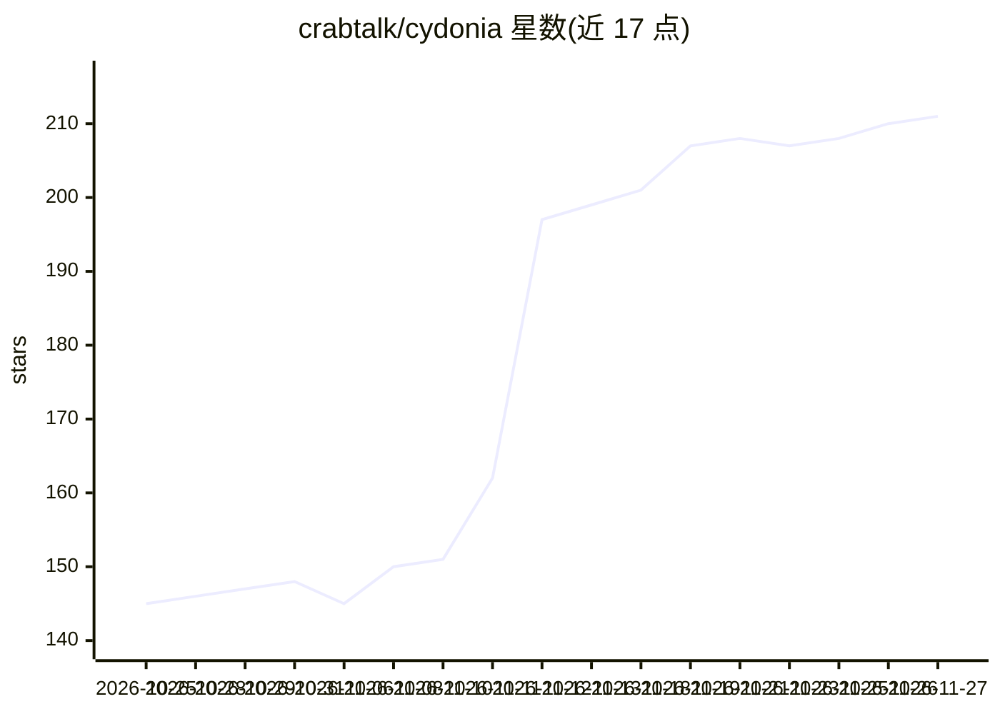

# crabtalk/cydonia

⭐ 211 · Rust · MIT · 推送 2026-11-25 · [GitHub](https://github.com/crabtalk/cydonia) · [官网](https://cydonia.sh) · 个人维护

**本地优先的 Agent 控制面板：让多个 ACP agent 共享工作区**

基于 Rust 与 GPUI 构建的桌面工作区应用，用户在自己的磁盘上与 ACP 协议的 agent（如 Claude Code、Codex、OpenCode、Pi 等）协作；项目以 articles 与 boards 组织 agent 会话与产出，agent 目录可从 ACP registry 安装或使用自定义 agent。配置与缓存位于 ~/.config/cydonia，项目数据写入 <project>/.cydonia 并自带 .gitignore，与项目源码隔离。提供 shell 安装脚本、Windows PowerShell 安装脚本及 cargo install 源码安装方式。

## 筛选速览

| 维度 | 判定 | 备注 |
|---|---|---|
| AI 角色 | `ai-ecosystem` | LLM/agent 周边工具 |
| 许可风险 | `permissive` | MIT |
| 部署形态 | `library` | 以包/库形式分发 |
| 模型依赖 | — | README 未给出锁定关系 |
| 硬件要求 | — | 无带数字的原话,不猜 |
| 安装摩擦 | `low` | 无编译、无系统依赖或容器化 |
| 成熟度 | — | 结构信号不足 |

## 能力要点

- 支持任意 ACP 协议 agent 共存于同一本地工作区
- 以 articles 与 boards 组织 agent 的会话与产出
- 从 ACP registry 安装 agent 或使用自定义 agent
- 本地优先：数据保存在用户磁盘，项目数据与源码隔离

## 适用场景

- 在桌面环境中同时管理多个编码 agent
- 集中查看与组织 agent 产生的会话和内容
- 按项目隔离 agent 的数据与配置

## 场景标签

 · 领域:开发者工具/AI agent 基础设施

## 证据(README 行号)

> L7: A workspace you share with your agents, on your own disk. Any
> L8: ACP agent works in it beside you.
> L34: - Installing agents: from the ACP

## 星数曲线

2026-10-25 145 → 2026-11-27 211（+66）

---
*卡片 v1 · prompt 1.4 · 生成 2026-11-25 · 置信度 mid · 依据 README sha `dd15024b9d49` · [字段定义](../../DATASET.md)*
