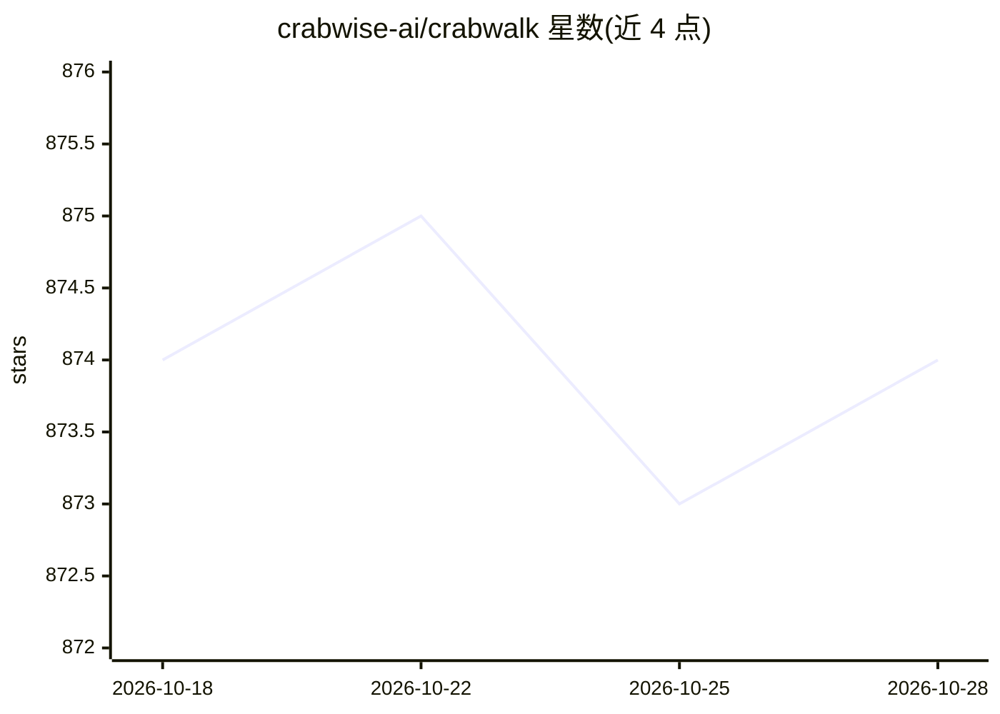

# crabwise-ai/crabwalk

⭐ 874 · TypeScript · MIT · 推送 2026-07-22 · [GitHub](https://github.com/crabwise-ai/crabwalk) · [官网](https://crabwalk.app) · 个人维护

**OpenClaw AI agent 的实时监控面板：节点图查看活动**

面向 OpenClaw（Clawdbot）agent 用户的实时监控工具：通过 WebSocket 连接 openclaw gateway，在 ReactFlow 节点图中展示跨 WhatsApp/Telegram/Discord/Slack 的 agent 会话、思考状态、工具调用与响应链，支持节点展开检查参数与载荷、按平台过滤。提供 CLI 二进制安装、Docker 镜像与源码运行三种方式，CLI 自动从 ~/.openclaw/openclaw.json 检测 token，启动时显示可扫码访问的二维码（需 qrencode）。限制：需本机运行 OpenClaw gateway。

## 筛选速览

| 维度 | 判定 | 备注 |
|---|---|---|
| AI 角色 | `ai-ecosystem` | LLM/agent 周边工具 |
| 许可风险 | `permissive` | MIT |
| 部署形态 | `self-host` | docker 或自建部署 |
| 模型依赖 | — | README 未给出锁定关系 |
| 硬件要求 | — | 无带数字的原话,不猜 |
| 安装摩擦 | `low` | 无编译、无系统依赖或容器化 |
| 成熟度 | — | 结构信号不足 |

## 能力要点

- ReactFlow 实时活动节点图，展示 agent 会话与动作链
- 跨 WhatsApp/Telegram/Discord/Slack 多平台同时监控
- 节点展开查看工具参数与载荷，按平台/收件人过滤
- Docker/CLI 二进制/源码三种安装方式，token 自动检测

## 适用场景

- 实时查看我的 agent 在各消息平台上的工作过程
- 排查 agent 的工具调用与响应链
- 用手机扫码远程查看监控面板

## 场景标签

`LLM 可观测性` · 领域:评测与运维

## 证据(README 行号)

> L3: Real-time companion monitor for OpenClaw (Clawdbot) agents by @luccasveg.
> L15: - **Real-time streaming** - WebSocket connection to openclaw gateway

## 星数曲线

2026-10-18 874 → 2026-10-28 874（+0）

---
*卡片 v1 · prompt 1.4 · 生成 2026-10-21 · 置信度 high · 依据 README sha `9e813d776f2b` · [字段定义](../../DATASET.md)*
