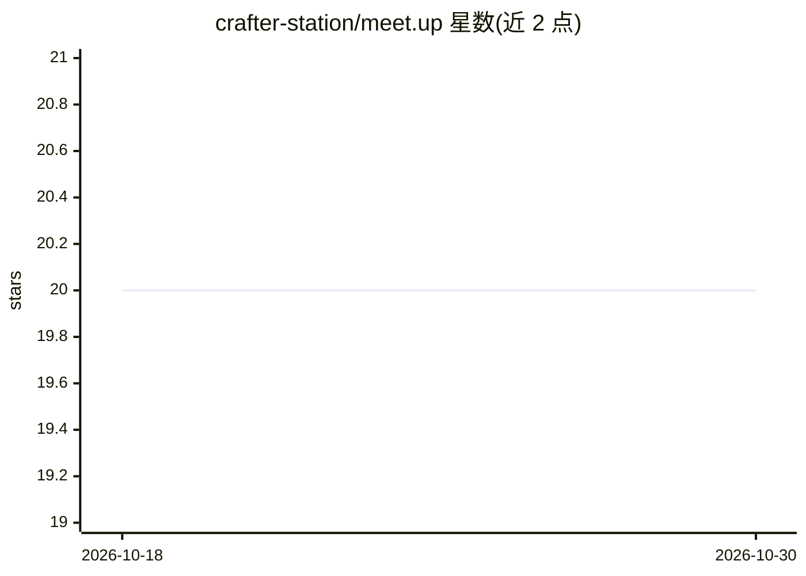

# crafter-station/meet.up

⭐ 20 · TypeScript · 推送 2026-03-31 · [GitHub](https://github.com/crafter-station/meet.up) · [官网](https://meetup.crafter.run) · 组织维护

**内置转录与 AI 笔记的视频会议应用**

meet.up 是一个基于 Next.js 的视频通话平台，在通话中内置实时转录（含说话人识别）、AI 总结（决策/行动项/要点）、会议 Feed 时间线，以及 GitHub、Google Calendar、网页搜索与 AI 聊天助手等集成。面向终端用户，浏览器中通过链接直接使用，无需下载或插件。AI 能力基于 Vercel AI SDK 与 Claude，本地部署需 Bun、PostgreSQL、Daily.co 与 Clerk 账号，并配置多项环境变量。

## 筛选速览

| 维度 | 判定 | 备注 |
|---|---|---|
| AI 角色 | `ai-enhanced` | 去掉 AI 部分产品仍成立 |
| 许可风险 | `none` | — |
| 部署形态 | `self-host` | docker 或自建部署 |
| 模型依赖 | — | README 未给出锁定关系 |
| 硬件要求 | — | 无带数字的原话,不猜 |
| 安装摩擦 | `low` | 无编译、无系统依赖或容器化 |
| 成熟度 | — | 结构信号不足 |

## 能力要点

- 实时转录并自动标注说话人
- 通话结束自动生成决策与行动项等 AI 总结
- GitHub/Notion/Jira 通过 MCP 集成，可在通话内创建 issue 与引用代码
- 浏览器内分享链接即可入会，无需下载或插件

## 适用场景

- 在一个应用内完成视频会议、转录与 AI 笔记，不再组合多个工具
- 会后自动获得决策与行动项记录
- 在通话中直接查 GitHub 仓库、日程与网页资料

## 场景标签

`语音识别` · 领域:感知与多模态

## 证据(README 行号)

> L43: meet.up is a video calling platform where transcription, AI notes, and summaries are built in. No need to stack Goo
> L7:  Video, transcription, and AI notes. No extra tools needed.

## 星数曲线

2026-10-18 20 → 2026-10-30 20（+0）

---
*卡片 v1 · prompt 1.4 · 生成 2026-10-28 · 置信度 mid · 依据 README sha `a9ddeb7afe34` · [字段定义](../../DATASET.md)*
