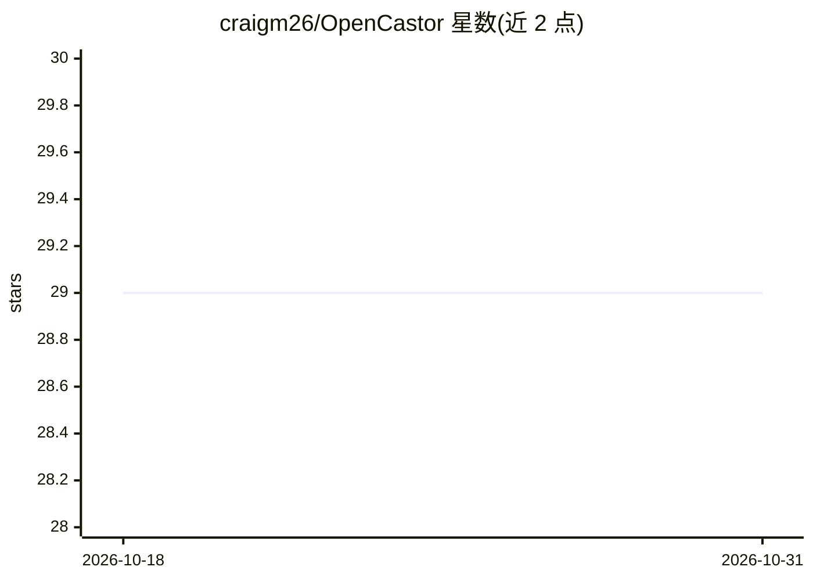

# craigm26/OpenCastor

⭐ 29 · Python · Apache-2.0 · 推送 2026-10-27 · [GitHub](https://github.com/craigm26/OpenCastor) · [官网](https://opencastor.com) · 个人维护

**开源机器人运行时：驱动、多提供商 AI 路由、车队管理与云桥**

OpenCastor 是一个开源机器人运行时（94,438 行 Python，7,334 测试，Python 3.10–3.13），实现 RCAN 开放协议，提供安全门控（Protocol 66，ESTOP 不可阻塞）、多提供商 AI 路由（Gemini/Claude/OpenAI/Ollama/Groq/DeepSeek 等 16 家，YAML 热切换）、18 种硬件预设（Raspberry Pi、Jetson、Arduino、ESP32、OAK-D、SO-ARM101 等）、消息通道（WhatsApp/Telegram/Discord/Slack/Home Assistant）、Fleet UI 云看板与 Sisyphus 自改进循环。面向机器人开发者/爱好者，通过 pip 安装，`castor up` 一条命令完成上电初始化；安全软件停机是 best-effort，非硬件切断。

## 筛选速览

| 维度 | 判定 | 备注 |
|---|---|---|
| AI 角色 | `ai-ecosystem` | LLM/agent 周边工具 |
| 许可风险 | `permissive` | Apache-2.0 |
| 部署形态 | `self-host` | docker 或自建部署 |
| 模型依赖 | local-ok | 支持本地模型 |
| 硬件要求 | — | 无带数字的原话,不猜 |
| 安装摩擦 | `low` | 无编译、无系统依赖或容器化 |
| 成熟度 | — | 结构信号不足 |

## 能力要点

- 多提供商 AI 路由（16 家提供商，YAML 一行热切换，含本地 Ollama/MLX）
- Protocol 66 安全层：ESTOP QoS 2、本地安全优先、GuardianAgent 否决权（当前符合度 94%）
- 18 种硬件预设与 SO-ARM101 机械臂 USB 自动检测
- Sisyphus PM→Dev→QA→Apply 自改进流水线从每次 episode 学习

## 适用场景

- 给自制机器人接入 LLM 大脑并通过 WhatsApp/Telegram 等对话控制
- 管理多台机器人的实时状态、审批与急停（Fleet UI）
- 在 Raspberry Pi/Jetson/Apple Silicon 上运行本地模型驱动的机器人
- 双臂 ALOHA 式 SO-ARM101 机械臂的引导式配置与运行

## 场景标签

`模型网关` · 领域:Agent 开发

## 证据(README 行号)

> L22: OpenCastor is an open-source robot runtime and product. It implements the RCAN open protocol and handles the hard p
> L146: - **Multi-provider AI** — Gemini, Claude, OpenAI, Ollama, MLX (Apple Silicon), Groq, DeepSeek, and 7 more; hot-swa

## 星数曲线

2026-10-18 29 → 2026-10-31 29（+0）

---
*卡片 v1 · prompt 1.4 · 生成 2026-10-26 · 置信度 mid · 依据 README sha `f3067fd676f3` · [字段定义](../../DATASET.md)*
