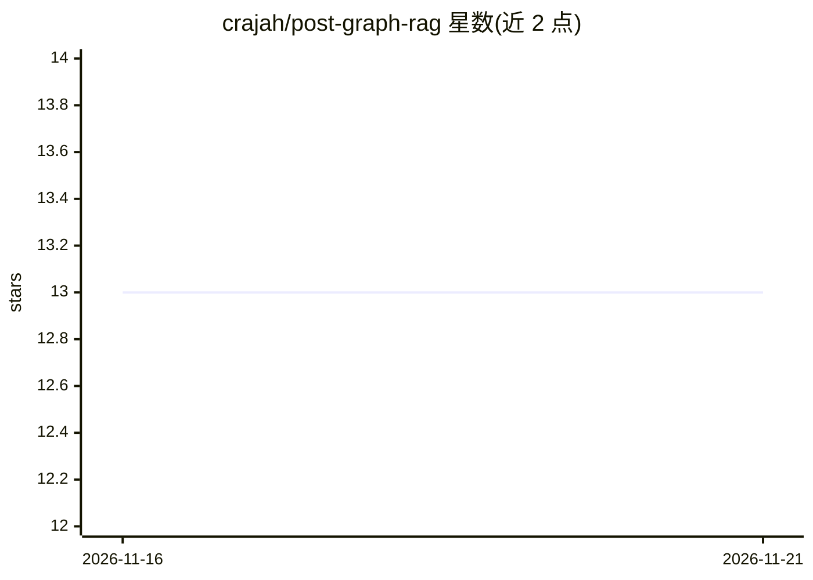

# crajah/post-graph-rag

⭐ 13 · Python · Apache-2.0 · 推送 2026-11-18 · [GitHub](https://github.com/crajah/post-graph-rag) · [官网](https://crajah.github.io/post-graph-rag/) · 个人维护

**Python GraphRAG 库：在 PostgreSQL 内做图+向量+全文混合检索**

以 Python 库形式发布的 Graph RAG 实现：用 LLM 抽取实体与关系存为属性图，与 pgvector 嵌入同库存储，检索时融合向量相似度、图遍历与全文搜索。核心机制是时序事实处理——后到的文档可关闭先前事实，否定关系以 negated 标记存储；实体按 (realm, space, name) 唯一并通过别名归并。依赖 Python 3.11+ 与 PostgreSQL 16/18 及 pgvector，通过 pip 安装，可用任意 OpenAI 兼容端点。底层的 post-graph 图层可独立使用。

## 筛选速览

| 维度 | 判定 | 备注 |
|---|---|---|
| AI 角色 | `ai-ecosystem` | LLM/agent 周边工具 |
| 许可风险 | `permissive` | Apache-2.0 |
| 部署形态 | `library` | 以包/库形式分发 |
| 模型依赖 | — | README 未给出锁定关系 |
| 硬件要求 | — | 无带数字的原话,不猜 |
| 安装摩擦 | `low` | 无编译、无系统依赖或容器化 |
| 成熟度 | — | 结构信号不足 |

## 能力要点

- 向量+图遍历+全文三路融合检索，数据与应用表同库同事务
- 时间感知：后写文档可关闭先前事实，否定关系以 negated:true 存储
- 实体别名归并与唯一索引约束，拒绝模糊关系与代词端点
- 可注入自定义 chunker 与 asyncpg 连接/连接池，支持多租户 SET ROLE

## 适用场景

- 在已有 PostgreSQL 上搭建带知识图谱的 RAG 问答
- 构建需要处理事实更新与时间推理的长期对话记忆
- 多租户应用中按 schema 隔离的文档索引与检索

## 场景标签

`知识图谱` `RAG` `Agent 记忆` · 领域:Agent 开发

## 证据(README 行号)

> L11: `post-graph-rag` extracts entities and relations with an LLM, stores them as a property graph beside `pgvector` emb
> L56: pip install post-graph-rag
> L59: **Needs Python 3.11+ and PostgreSQL 16 or 18 with `pgvector`.** CI runs 3.11

## 星数曲线

2026-11-16 13 → 2026-11-21 13（+0）

---
*卡片 v1 · prompt 1.4 · 生成 2026-11-18 · 置信度 high · 依据 README sha `4afbed69e86a` · [字段定义](../../DATASET.md)*
