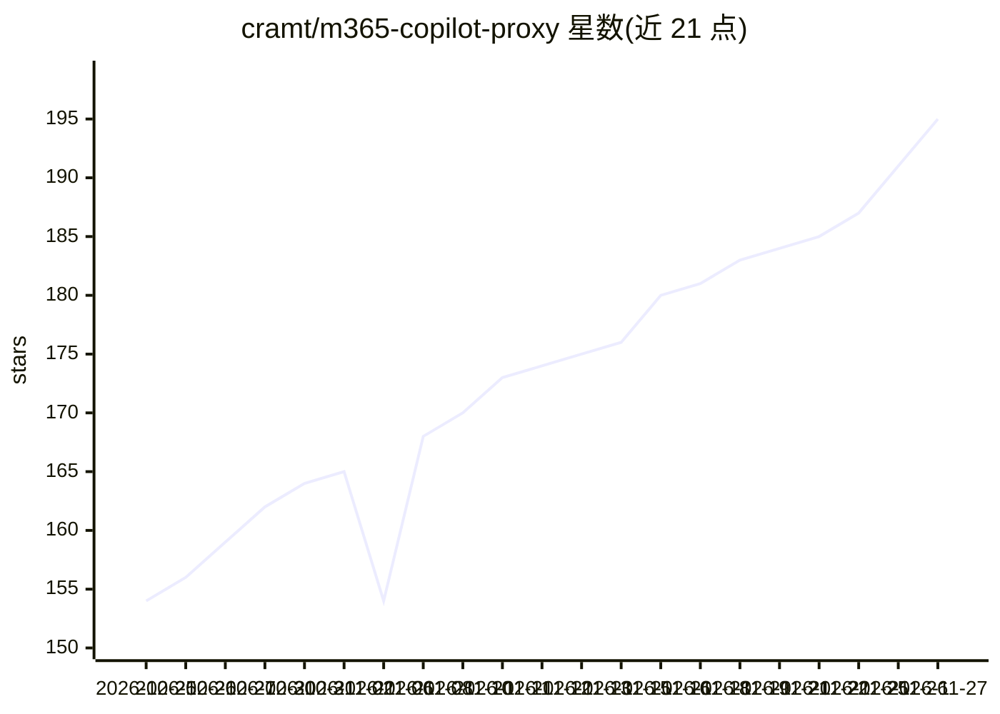

# cramt/m365-copilot-proxy

⭐ 195 · TypeScript · MIT · 推送 2026-11-26 · [GitHub](https://github.com/cramt/m365-copilot-proxy) · 个人维护

**把已有 M365 Copilot 许可包装成 OpenAI 兼容后端的代理**

该仓库将 Microsoft 365 Copilot 的 SignalR WebSocket 协议翻译为 OpenAI 兼容的 /v1/chat/completions 与 /v1/models 接口，供 pi、OpenClaw 等编码 agent 把企业 Copilot 许可当作 LLM 后端使用。因 M365 不原生支持 tool_calls，项目通过提示内注入 Markdown 围栏模板模拟工具调用，并借助 Copilot Studio agent 与 shell 块路由实现多轮 agent 循环。会话跨轮复用以节省每会话 600 条消息配额，并支持 reasoning_content 透传。要求工作/学校 Entra ID 账户，个人账户不受支持；登录需 TOTP 种子或交互式浏览器批准。

## 筛选速览

| 维度 | 判定 | 备注 |
|---|---|---|
| AI 角色 | `ai-ecosystem` | LLM/agent 周边工具 |
| 许可风险 | `permissive` | MIT |
| 部署形态 | `library` | 以包/库形式分发 |
| 模型依赖 | — | README 未给出锁定关系 |
| 硬件要求 | — | 无带数字的原话,不猜 |
| 安装摩擦 | `low` | 无编译、无系统依赖或容器化 |
| 成熟度 | — | 结构信号不足 |

## 能力要点

- OpenAI 兼容代理端点 /v1/chat/completions 与 /v1/models
- 以 Markdown 围栏格式模拟 tool_calls 并转换为 OpenAI 格式
- 通过 PowerPlatform/BAP API 自动创建并缓存 Copilot Studio agent
- 每会话复用 M365 会话上下文以节省 600 条消息配额

## 适用场景

- 让 pi、OpenClaw 等编码 agent 复用公司已有的 M365 Copilot 许可作为模型后端
- 为 OpenAI 兼容客户端提供带工具调用的 M365 Copilot 接入通道
- 查阅 M365 Copilot 未公开 WebSocket 协议的详细文档（auth/SignalR/节流）

## 场景标签

`模型网关` · 领域:Agent 开发

## 证据(README 行号)

> L3: Use Microsoft 365 Copilot as an LLM backend for OpenAI-compatible coding agents like pi and OpenClaw. Wraps M365 Cop
> L11: 1. **Standalone proxy** — HTTP server with `/v1/chat/completions` and `/v1/models` endpoints. Works with any OpenAI

## 星数曲线

2026-10-25 154 → 2026-11-27 195（+41）

---
*卡片 v1 · prompt 1.4 · 生成 2026-11-26 · 置信度 mid · 依据 README sha `d7c0a9461cca` · [字段定义](../../DATASET.md)*
