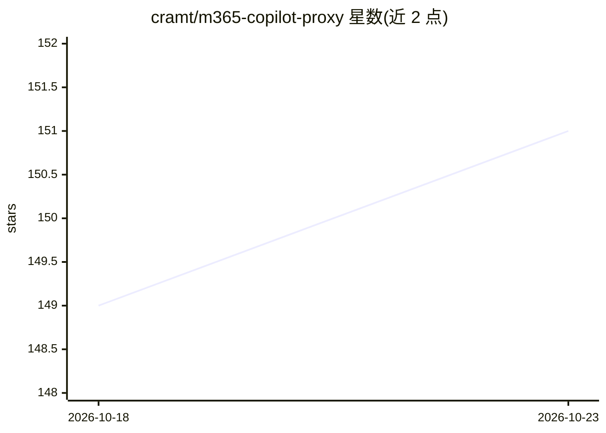

# cramt/m365-copilot-proxy

⭐ 151 · TypeScript · MIT · 推送 2026-10-19 · [GitHub](https://github.com/cramt/m365-copilot-proxy) · 个人维护

**把 M365 Copilot 许可证封装成 OpenAI 兼容 API 的代理**

TypeScript 实现的代理服务：将 Microsoft 365 Copilot 的 WebSocket/SignalR 协议翻译为 OpenAI 兼容的 /v1/chat/completions 接口，供 pi、OpenClaw 等 coding agent 作为 LLM 后端使用。因 M365 Copilot 原生不支持 tool_calls，采用提示注入的 Markdown 围栏格式模拟工具调用，并通过 PowerPlatform API 自动创建带工具指令的 Copilot Studio agent。限制：需工作/学校 Entra ID 账号，个人微软账号不支持；登录依赖 TOTP 密钥或一次性交互审批；存在按账号的限流预算。提供独立代理、OpenClaw 插件与 NixOS 模块三种形态。

## 筛选速览

| 维度 | 判定 | 备注 |
|---|---|---|
| AI 角色 | `ai-ecosystem` | LLM/agent 周边工具 |
| 许可风险 | `permissive` | MIT |
| 部署形态 | `library` | 以包/库形式分发 |
| 模型依赖 | — | README 未给出锁定关系 |
| 硬件要求 | — | 无带数字的原话,不猜 |
| 安装摩擦 | `low` | 无编译、无系统依赖或容器化 |
| 成熟度 | — | 结构信号不足 |

## 能力要点

- 将 M365 Copilot 的 SignalR 协议封装为 OpenAI 兼容 HTTP 接口
- 提示注入 + 围栏格式模拟 tool_calls，shell 路由实现多轮代理循环
- 自动创建 Copilot Studio agent 并缓存 agent ID
- 会话复用与临时聊天模式，节约 M365 配额

## 适用场景

- 用已有的 M365 Copilot 许可证驱动 pi/OpenClaw 等 coding agent
- 让任意 OpenAI 兼容客户端调用企业 Copilot 服务
- 在 NixOS 上以 systemd 服务方式部署

## 场景标签

`模型网关` · 领域:Agent 开发

## 证据(README 行号)

> L3: Use Microsoft 365 Copilot as an LLM backend for OpenAI-compatible coding agents like pi and OpenClaw. Wraps M365 Cop
> L11: 1. **Standalone proxy** — HTTP server with `/v1/chat/completions` and `/v1/models` endpoints. Works with any OpenAI

## 星数曲线

2026-10-18 149 → 2026-10-23 151（+2）

---
*卡片 v1 · prompt 1.4 · 生成 2026-10-23 · 置信度 high · 依据 README sha `12d910996b35` · [字段定义](../../DATASET.md)*
