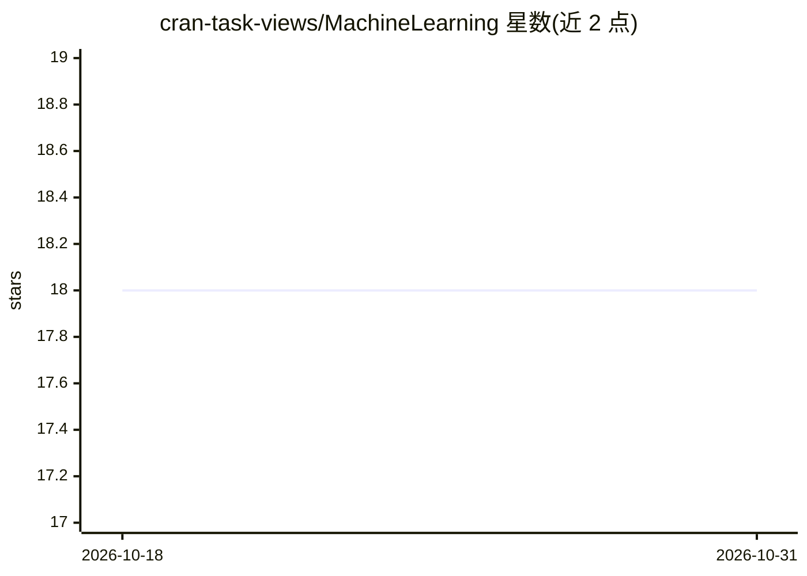

# cran-task-views/MachineLearning

⭐ 18 · 推送 2026-09-21 · [GitHub](https://github.com/cran-task-views/MachineLearning) · [官网](https://CRAN.R-project.org/view=MachineLearning) · 组织维护

**R 语言机器学习包的 CRAN 任务视图清单**

CRAN 官方任务视图仓库中机器学习与统计学习分区的镜像/源文件仓库，内容为按主题组织的 R 包清单（含各子领域分类条目与维护人信息）。面向 R 用户与开发者，用于发现和选择机器学习相关的 CRAN 包。贡献通过 GitHub issue/PR 或邮件进行。仓库本身不含代码实现，仅维护 MachineLearning.md 源文件并发布至 CRAN 任务视图页面。

## 筛选速览

| 维度 | 判定 | 备注 |
|---|---|---|
| AI 角色 | `ai-knowledge` | 知识聚合/清单类 |
| 许可风险 | `none` | — |
| 部署形态 | `None` |  |
| 模型依赖 | — | README 未给出锁定关系 |
| 硬件要求 | — | 无带数字的原话,不猜 |
| 安装摩擦 | `low` | 无编译、无系统依赖或容器化 |
| 成熟度 | — | 结构信号不足 |

## 能力要点

- 按主题组织的 R 机器学习包分类清单
- 以 MachineLearning.md 源文件维护并发布到 CRAN
- 通过 GitHub issue/PR 或邮件接受社区贡献

## 适用场景

- R 用户查找特定机器学习任务可用的 CRAN 包
- 了解 R 生态中机器学习包的分类结构
- 通过 issue/PR 为清单补充包条目

## 场景标签

`精选清单` · 领域:学习与行业

## 证据(README 行号)

> L1: ## CRAN Task View: Machine Learning & Statistical Learning
> L5: **Source file:** MachineLearning.md

## 星数曲线

2026-10-18 18 → 2026-10-31 18（+0）

---
*卡片 v1 · prompt 1.4 · 生成 2026-10-29 · 置信度 high · 依据 README sha `b3253038e53d` · [字段定义](../../DATASET.md)*
