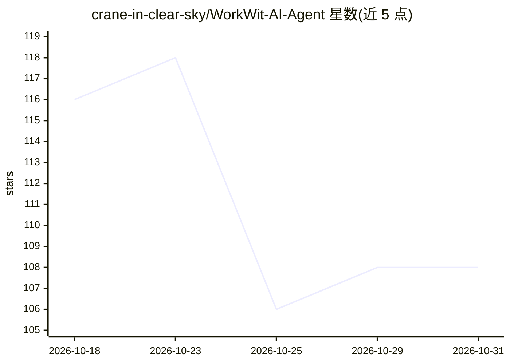

# crane-in-clear-sky/WorkWit-AI-Agent

⭐ 108 · Python · 推送 2026-08-27 · [GitHub](https://github.com/crane-in-clear-sky/WorkWit-AI-Agent) · 个人维护 · 中文 README

**企业私有化部署的 AI Agent 办公平台，内置合同审核与简历筛选**

面向企业的自托管 AI Agent 平台：后端 FastAPI + SQLite，前端零依赖原生 JS 单页应用，一条 docker compose up 部署。核心机制包括 ReAct Agent 内核、40+ 内置技能与技能广场、工具库、MCP 连接器、沙箱执行、组织/部门/用户三级多租户 RBAC、定时自动化与长期记忆。合同审核（可选甲方/乙方立场）和简历筛选（岗位匹配评分）开箱即用。模型接入走 OpenAI 兼容接口，需提供 chat/vision/embed/rerank 四类端点，可直连 vLLM/Ollama 或经 LiteLLM 网关。限制：当前单容器单数据库，不支持横向扩展；默认账号需在生产环境修改。

## 筛选速览

| 维度 | 判定 | 备注 |
|---|---|---|
| AI 角色 | `ai-native` | 本体是模型或模型工具 |
| 许可风险 | `none` | — |
| 部署形态 | `self-host` | docker 或自建部署 |
| 模型依赖 | local-ok | 支持本地模型 |
| 硬件要求 | — | 无带数字的原话,不猜 |
| 安装摩擦 | `low` | 无编译、无系统依赖或容器化 |
| 成熟度 | — | 结构信号不足 |

## 能力要点

- ReAct Agent 内核，支持工具调用、流式输出与多步任务拆解
- 40+ 内置技能、技能广场、工具库与 MCP 连接器框架
- 沙箱执行用户代码：AST 扫描 + 资源限额 + 降权
- 多租户 RBAC（组织/部门/用户）与定时自动化、长期记忆

## 适用场景

- 组织内部私有化部署 AI 办公助手，数据不出服务器
- 用自然语言下达任务让 Agent 自动规划并调用技能完成
- 对合同按立场做风险审查，或按岗位画像筛选简历

## 场景标签

`AI 助手` · 领域:对话与助手

## 证据(README 行号)

> L5: An enterprise-oriented, privately deployable **AI Agent platform**. The backend is built on FastAPI + SQLite, and th
> L96: - **Contract Review**: upload txt / docx / pdf, select your stance (Party A / Party B), and get structured risk poi
> L98: - **Agent**: issue tasks in natural language; it auto-plans and invokes skills / tools to complete them. Supports s

## 星数曲线

2026-10-18 116 → 2026-10-31 108（-8）

---
*卡片 v1 · prompt 1.4 · 生成 2026-10-23 · 置信度 high · 依据 README sha `050584c17013` · [字段定义](../../DATASET.md)*
