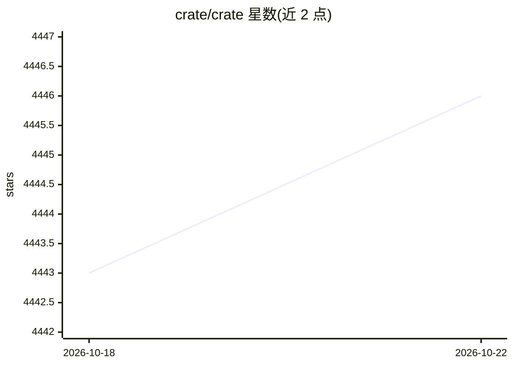

# crate/crate

⭐ 4,446 · Java · Apache-2.0 · 推送 2026-10-21 · [GitHub](https://github.com/crate/crate) · [官网](https://cratedb.com/database) · 组织维护

**分布式 SQL 数据库：海量数据近实时存储与分析**

CrateDB 是基于 Lucene 的分布式 SQL 数据库，兼容 PostgreSQL wire protocol，同时提供 HTTP API。支持动态表结构、文档型查询对象、时间序列数据、全文检索、地理空间类型；集群具备水平扩展、auto-sharding、auto-replication、自愈与自动再平衡能力，可在 Kubernetes/AWS/Azure 等容器化环境运行。面向物联网与分析场景的海量数据存储，由 Crate.io 团队维护，另有托管的 CrateDB Cloud 服务。

## 筛选速览

| 维度 | 判定 | 备注 |
|---|---|---|
| AI 角色 | `ai-ecosystem` | LLM/agent 周边工具 |
| 许可风险 | `permissive` | Apache-2.0 |
| 部署形态 | `self-host` | docker 或自建部署 |
| 模型依赖 | — | README 未给出锁定关系 |
| 硬件要求 | — | 无带数字的原话,不猜 |
| 安装摩擦 | `low` | 无编译、无系统依赖或容器化 |
| 成熟度 | — | 结构信号不足 |

## 能力要点

- 标准 SQL，经 PostgreSQL wire protocol 或 HTTP API 访问
- 支持时间序列、全文检索、地理空间数据类型
- auto-partitioning/auto-sharding/auto-replication 与自愈集群
- 提供 Admin UI 与官方 Docker 镜像

## 适用场景

- 物联网设备数据的海量近实时存储与分析
- 在 Kubernetes 上部署水平扩展的 SQL 数据库集群
- 用标准 SQL 对大数据集做 ad-hoc 查询

## 场景标签

 · 领域:数据库/大数据分析

## 证据(README 行号)

> L20: CrateDB is a distributed SQL database that makes it simple to store and analyze
> L26: sweat. You can run ad-hoc queries using `standard SQL`_. CrateDB's blazing-fast

## 星数曲线

2026-10-18 4,443 → 2026-10-22 4,446（+3）

---
*卡片 v1 · prompt 1.4 · 生成 2026-10-20 · 置信度 low · 依据 README sha `1fc41fd741ce` · [字段定义](../../DATASET.md)*
