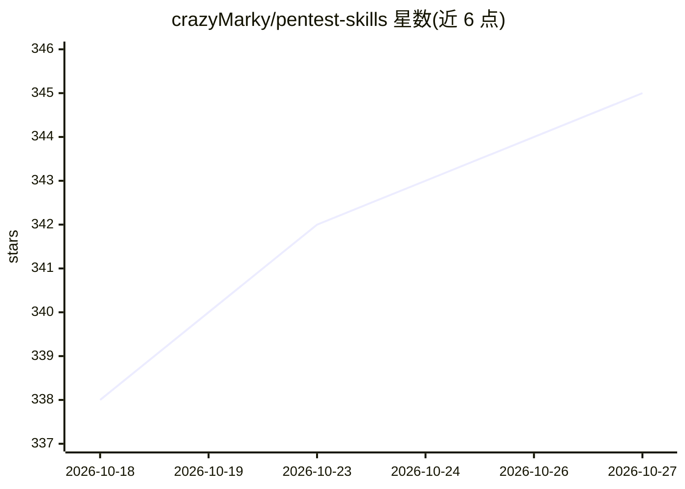

# crazyMarky/pentest-skills

⭐ 345 · Python · Apache-2.0 · 推送 2026-06-04 · [GitHub](https://github.com/crazyMarky/pentest-skills) · 个人维护 · 中文 README

**面向 AI CLI 工具的模块化渗透测试技能集合**

为 Claude Code 等 AI Coding CLI 设计的渗透测试技能包：每个技能由 SKILL.md 知识文档、Python/Bash 辅助脚本、参考文档和资源文件（字典、载荷）组成，覆盖信息收集（端口扫描、子域名枚举、目录扫描、指纹识别）与漏洞利用（SQL 注入、XSS、LFI、不安全文件下载）等类别。用户以自然语言描述测试需求，AI CLI 据此选择工具（nmap、sqlmap、ffuf 等）执行命令并生成分析报告。安装方式为 git clone 后复制到 .claude/skills/ 目录；仅限授权安全测试使用。

## 筛选速览

| 维度 | 判定 | 备注 |
|---|---|---|
| AI 角色 | `ai-knowledge` | 知识聚合/清单类 |
| 许可风险 | `permissive` | Apache-2.0 |
| 部署形态 | `library` | 以包/库形式分发 |
| 模型依赖 | — | README 未给出锁定关系 |
| 硬件要求 | — | 无带数字的原话,不猜 |
| 安装摩擦 | `low` | 无编译、无系统依赖或容器化 |
| 成熟度 | — | 结构信号不足 |

## 能力要点

- 技能结构含 SKILL.md 触发文档、辅助脚本、参考文档与资源文件
- 覆盖侦察与漏洞利用等类别的技能，配合 nmap/sqlmap/ffuf 等工具
- 需先安装 Claude Code 或其他兼容 AI CLI 工具
- Apache 2.0 许可，声明仅限授权安全测试与教育用途

## 适用场景

- 用自然语言驱动端口扫描、子域名枚举等侦察任务
- 让 AI CLI 检测并验证 SQL 注入、XSS 等漏洞
- 在授权渗透测试或 CTF 比赛中降低命令行使用门槛

## 场景标签

`网络安全` · 领域:学习与行业

## 证据(README 行号)

> L3: > 专为 AI CLI 工具（Claude Code / Gemini CLI）设计的模块化渗透测试技能集合。
> L17: Pentest-Skills 为渗透测试工作流程提供原子级能力。每个技能包含：
> L19: - **知识文档** - 命令模板和工具使用指南

## 星数曲线

2026-10-18 338 → 2026-10-27 345（+7）

---
*卡片 v1 · prompt 1.4 · 生成 2026-10-22 · 置信度 high · 依据 README sha `ad4c9d1d9fdb` · [字段定义](../../DATASET.md)*
