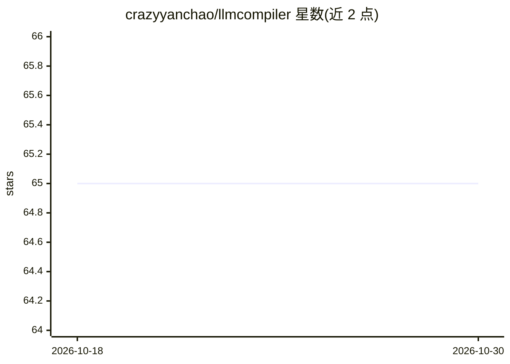

# crazyyanchao/llmcompiler

⭐ 65 · Python · Apache-2.0 · 推送 2025-11-06 · [GitHub](https://github.com/crazyyanchao/llmcompiler) · 个人维护 · 中文 README

**Agent 架构：将 LLM 工具调用编排为 DAG 并行执行**

LLMCompiler 是一种 Agent 架构实现：Planner 将用户请求解析为任务 DAG（DAG 描述工具调用关系与参数依赖），Task Fetching Unit 按依赖调度并行执行任务，Joiner 评估结果并可在不足时重规划。目标是加速 agent 任务执行并减少对 LLM 的冗余调用。灵感来自论文 An LLM Compiler for Parallel Function Calling。适用于需要调用大量工具的 agent 场景，README 提及约 60 个工具配置下配合 few-shot 的生产案例。以 pip 包形式提供，示例代码使用 langchain_openai 的 ChatOpenAI。

## 筛选速览

| 维度 | 判定 | 备注 |
|---|---|---|
| AI 角色 | `ai-ecosystem` | LLM/agent 周边工具 |
| 许可风险 | `permissive` | Apache-2.0 |
| 部署形态 | `library` | 以包/库形式分发 |
| 模型依赖 | — | README 未给出锁定关系 |
| 硬件要求 | — | 无带数字的原话,不猜 |
| 安装摩擦 | `low` | 无编译、无系统依赖或容器化 |
| 成熟度 | — | 结构信号不足 |

## 能力要点

- Planner 将用户请求解析为任务 DAG（工具调用关系与参数依赖）
- Task Fetching Unit 按依赖调度、尽可能并行执行任务
- Joiner 评估执行结果，不足时重规划再执行
- 面向大量工具调用场景，README 提及约 60 个工具配合 few-shot 的生产案例

## 适用场景

- 让 agent 同时调用多个工具时并行执行以减少总耗时
- 工具数量超过 LLM 上下文限制时拆分为多个 agent 节点组装
- 降低多工具 agent 的冗余 token 消耗

## 场景标签

`Agent 框架` · 领域:Agent 开发

## 证据(README 行号)

> L6: &emsp;LLMCompiler is an Agent Architecture designed to speed up the execution of agent tasks by executing them quick
> L10: &emsp;Here is an example of using SQL to query data to illustrate the core role of the framework. The core process 

## 星数曲线

2026-10-18 65 → 2026-10-30 65（+0）

---
*卡片 v1 · prompt 1.4 · 生成 2026-10-24 · 置信度 high · 依据 README sha `f1b43e55f9a3` · [字段定义](../../DATASET.md)*
