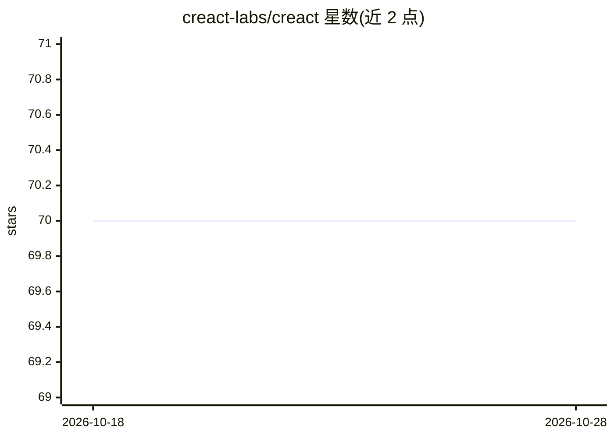

# creact-labs/creact

⭐ 70 · TypeScript · Apache-2.0 · 推送 2026-08-18 · [GitHub](https://github.com/creact-labs/creact) · [官网](https://creact-labs.github.io/creact/) · 组织维护

**用 JSX 声明并运行持久化工作流/任务/基础设施的框架**

CReact 提供以 JSX 语法声明式编写工作流的方式：开发者声明期望存在的资源或流程，运行时对比实际状态并调和差异，追踪依赖、管理生命周期，并在重启后保持状态持久化。可用于构建 durable 应用、作业（jobs）、agent 与基础设施等。README 信息有限，主要引导至 GitHub Pages 文档站与社区渠道。

## 筛选速览

| 维度 | 判定 | 备注 |
|---|---|---|
| AI 角色 | `ai-ecosystem` | LLM/agent 周边工具 |
| 许可风险 | `permissive` | Apache-2.0 |
| 部署形态 | `None` |  |
| 模型依赖 | — | README 未给出锁定关系 |
| 硬件要求 | — | 无带数字的原话,不猜 |
| 安装摩擦 | `low` | 无编译、无系统依赖或容器化 |
| 成熟度 | — | 结构信号不足 |

## 能力要点

- 以 JSX 声明工作流与基础设施
- 运行时调和声明与实际状态的差异
- 依赖追踪、生命周期管理与跨重启的状态持久化

## 适用场景

- 用 JSX 声明并自动执行持久化工作流
- 构建随外部状态同步的 durable 应用或作业
- 以声明式方式管理 agent 与基础设施

## 场景标签

`工作流自动化` · 领域:效率与自动化

## 证据(README 行号)

> L11: Use JSX to automate durable workflows. Declare what should exist, and runtime reconciles the difference, tracking d

## 星数曲线

2026-10-18 70 → 2026-10-28 70（+0）

---
*卡片 v1 · prompt 1.4 · 生成 2026-10-24 · 置信度 mid · 依据 README sha `e5cf1bf1cfc9` · [字段定义](../../DATASET.md)*
