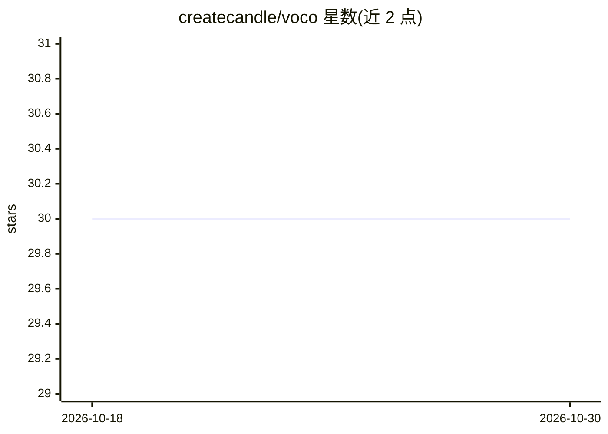

# createcandle/voco

⭐ 30 · Python · MPL-2.0 · 推送 2026-08-17 · [GitHub](https://github.com/createcandle/voco) · [官网](https://www.candlesmarthome.com/voco-privacy-friendly-voice-control) · 个人维护

**面向 Candle/WebThings 智能家居的 100% 本地语音控制与 AI 助手**

以 add-on 形式安装到 Candle Controller / WebThings Gateway 的语音控制组件：通过唤醒词（"Hey Snips"/"Hey Candle"）后说出自然语言指令，即可开关设备、定时/限时操作、设置闹钟提醒、查询传感器数值，并新增基于本地 LLM 的 AI 助手功能。构建于 Snips 之上，安装后无需联网，监听可开关，支持多房间 satellite 设备经本地网络通信。推荐使用 PlayStation Eye 四麦克风阵列接入树莓派。受欧盟 H2020 SHERPA 项目与荷兰创意产业基金支持。

## 筛选速览

| 维度 | 判定 | 备注 |
|---|---|---|
| AI 角色 | `ai-native` | 本体是模型或模型工具 |
| 许可风险 | `permissive` | MPL-2.0 |
| 部署形态 | `None` |  |
| 模型依赖 | — | README 未给出锁定关系 |
| 硬件要求 | — | 无带数字的原话,不猜 |
| 安装摩擦 | `low` | 无编译、无系统依赖或容器化 |
| 成熟度 | — | 结构信号不足 |

## 能力要点

- 100% 本地运行，安装后无需联网，监听可开关
- 自然语言控制设备：开关、定时、限时、查询传感器、闹钟提醒
- 基于本地 LLM 的 AI 助手功能
- 支持 satellite 设备扩展多房间语音控制

## 适用场景

- 在 Candle 智能家居中用语音开关灯、门锁与家电
- 通过语音设置定时器、闹钟与提醒
- 不依赖云服务地对全屋设备进行多房间语音控制

## 场景标签

`语音 Agent` `AI 助手` · 领域:对话与助手

## 证据(README 行号)

> L12: _New 100% local AI assistant features using "Large Language Models" (LLM's)_
> L82: Voco is built on Snips

## 星数曲线

2026-10-18 30 → 2026-10-30 30（+0）

---
*卡片 v1 · prompt 1.4 · 生成 2026-10-26 · 置信度 high · 依据 README sha `5abb6dce802f` · [字段定义](../../DATASET.md)*
