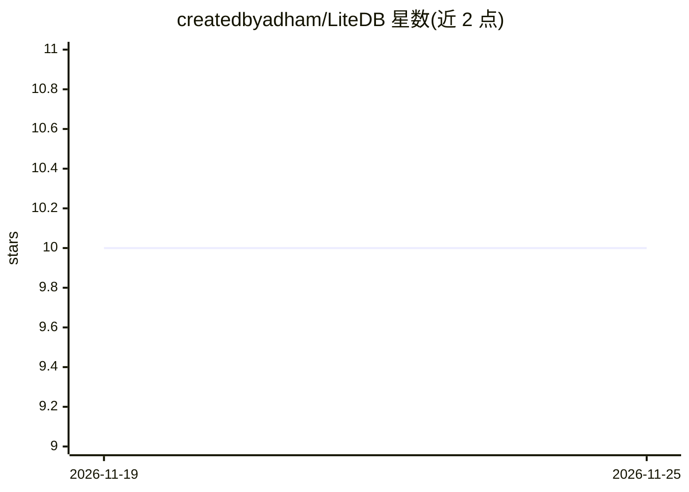

# createdbyadham/LiteDB

⭐ 10 · TypeScript · MIT · 推送 2026-11-18 · [GitHub](https://github.com/createdbyadham/LiteDB) · [官网](https://litedb-landing.vercel.app/) · 个人维护

**带 AI 写入护栏的 SQLite/PostgreSQL 桌面 SQL 客户端**

Tauri + Rust + React 构建的桌面数据库客户端，支持 SQLite 原生读写与 PostgreSQL 连接（含 Supabase、SSH 隧道、生产标签只读）。AI 相关机制：内置 MCP 服务器让 Claude Code/Cursor 等 agent 连接，所有写入需在应用内逐条批准、记录审计日志并可撤销；Text-to-SQL 支持本地模型（默认 Ollama），采用 schema 注入、示例值、few-shot 与编译修复的流水线，并附带 109 例执行准确率公开基准。三平台提供安装包，Windows 安装包尚未代码签名。

## 筛选速览

| 维度 | 判定 | 备注 |
|---|---|---|
| AI 角色 | `ai-enhanced` | 去掉 AI 部分产品仍成立 |
| 许可风险 | `permissive` | MIT |
| 部署形态 | `desktop` | 安装包/桌面程序 |
| 模型依赖 | local-ok | 支持本地模型 |
| 硬件要求 | — | 无带数字的原话,不猜 |
| 安装摩擦 | `low` | 无编译、无系统依赖或容器化 |
| 成熟度 | — | 结构信号不足 |

## 能力要点

- MCP 服务器：agent 写入需应用内批准，附审计日志与撤销
- Text-to-SQL 流水线：schema 注入、示例值、K=3 few-shot、编译修复
- 109 例执行准确率公开基准，含留出集与复现命令
- pgvector 语义搜索与本地 embedding 模型（Transformers.js）

## 适用场景

- 让 AI agent 操作数据库但拦截危险写入
- 在本地模型下用自然语言生成 SQL 查询
- 通过可视化 ERD 查看表关系与外键
- 对 Postgres 数据做基于 pgvector 的语义搜索

## 场景标签

`数据分析` `语义搜索` · 领域:效率与自动化

## 证据(README 行号)

> L3: A desktop database client for SQLite and PostgreSQL that lets AI agents in
> L56: - **AI Agent (Text-to-SQL)**: Turn natural language into SQL queries.
> L59: - **MCP**: Settings → **Agents**, or the status-bar **MCP** chip. Claude Desktop / Claude Code / Cursor / OpenCode 

## 星数曲线

2026-11-19 10 → 2026-11-25 10（+0）

---
*卡片 v1 · prompt 1.4 · 生成 2026-11-19 · 置信度 mid · 依据 README sha `65a36bde5fa5` · [字段定义](../../DATASET.md)*
