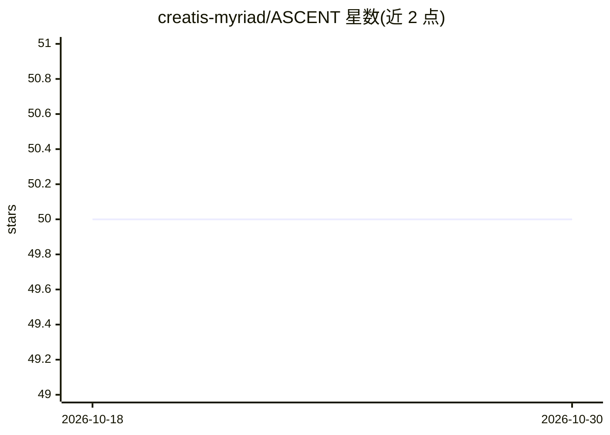

# creatis-myriad/ASCENT

⭐ 50 · Python · Apache-2.0 · 推送 2026-04-13 · [GitHub](https://github.com/creatis-myriad/ASCENT) · 组织维护

**心脏超声图像分割与彩色多普勒解卷绕工具箱**

ASCENT 是面向心脏超声图像分析的深度学习工具箱：对超声图像做心脏结构（左心室、右心室等）分割，并对彩色多普勒超声心动图做相位解卷绕（dealiasing）。实现上将 nnUNet（V1）的超参数启发式规则与 PyTorch Lightning、Hydra、Monai 组合，提供 nnUNet 2D 与 3D_fullres 架构，并可插入自定义模型。工作流覆盖数据集格式转换、预处理与规划、10 折交叉验证训练、评估、推理（含测试时增强），以及通过 W&B/TensorBoard 等做实验跟踪。以 git clone 源码方式安装，需先自行安装 PyTorch。

## 筛选速览

| 维度 | 判定 | 备注 |
|---|---|---|
| AI 角色 | `ai-native` | 本体是模型或模型工具 |
| 许可风险 | `permissive` | Apache-2.0 |
| 部署形态 | `library` | 以包/库形式分发 |
| 模型依赖 | — | README 未给出锁定关系 |
| 硬件要求 | — | 无带数字的原话,不猜 |
| 安装摩擦 | `medium` | 含编译或系统依赖之一 |
| 成熟度 | — | 结构信号不足 |

## 能力要点

- 心脏超声结构分割与彩色多普勒解卷绕
- 组合 nnUNet V1 启发式超参数规则与 Lightning/Hydra/Monai
- 提供预处理、10 折交叉验证训练、评估、推理（含 TTA）完整流程命令
- 支持 W&B、TensorBoard 等 Lightning 日志框架做实验跟踪

## 适用场景

- 在 CAMUS/ACDC 等心脏超声数据集上训练分割模型
- 对彩色多普勒超声做相位解卷绕处理
- 用命令行覆盖 Hydra 配置灵活调整训练与推理参数

## 场景标签

`目标检测` · 领域:感知与多模态

## 证据(README 行号)

> L28: ASCENT is a toolbox to segment cardiac structures (left ventricle, right ventricle, etc.) on
> L30: best segmentation framework, nnUNet with

## 星数曲线

2026-10-18 50 → 2026-10-30 50（+0）

---
*卡片 v1 · prompt 1.4 · 生成 2026-10-24 · 置信度 mid · 依据 README sha `1795a6856e50` · [字段定义](../../DATASET.md)*
