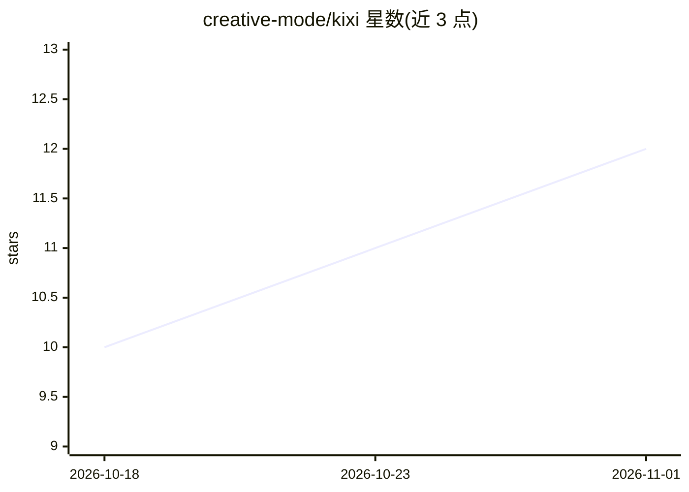

# creative-mode/kixi

⭐ 12 · Java · NOASSERTION · 推送 2026-10-31 · [GitHub](https://github.com/creative-mode/kixi) · 组织维护

**安哥拉考试平台：试题管理、模拟考试、OCR 导入与 AI 导师**

面向教师与学生的考试管理与模拟平台后端及 OCR 服务。教师可手动或通过拍照经 OCR 导入试题构建题库；学生参加模拟考试并获得基于答案卡的自动评分，可与同班、同校及按百分位做全国比较（需同意且设最低人数门槛）。功能还包括按单份试题的流式 AI 导师会话、多级排名（均分/XP）、社区动态与 JWT/RBAC 认证。后端基于 Java 17 + Spring WebFlux + PostgreSQL，模块化组织，通过 Docker Compose 启动；采用 Apache 2.0 附加 Commons Clause 限制，禁止作为独立产品或竞争服务销售。

## 筛选速览

| 维度 | 判定 | 备注 |
|---|---|---|
| AI 角色 | `ai-enhanced` | 去掉 AI 部分产品仍成立 |
| 许可风险 | `none` | NOASSERTION |
| 部署形态 | `self-host` | docker 或自建部署 |
| 模型依赖 | — | README 未给出锁定关系 |
| 硬件要求 | — | 无带数字的原话,不猜 |
| 安装摩擦 | `low` | 无编译、无系统依赖或容器化 |
| 成熟度 | — | 结构信号不足 |

## 能力要点

- 拍照导入试题，OCR 服务读取并自动填充题库构建器
- 按单份试题限定的 AI 导师会话，支持流式输出
- 班级/学校/全国（校内百分位）多级排名，含同意机制
- 13 个后端模块，架构规则由 ArchitectureTest 强制校验

## 适用场景

- 教师组建题库并发布班级模拟考试
- 学生参加模拟考试、查看成绩与排名
- 通过 AI 导师针对某份试题进行答疑
- 拍照将纸质试卷数字化为可编辑试题

## 场景标签

`OCR` `文档问答` · 领域:知识与检索

## 证据(README 行号)

> L38: - **Tutor com IA.** Sessões de conversa limitadas a um enunciado, com resposta em streaming.
> L15: fotografia, e um serviço de OCR lê a prova e preenche o construtor. Os alunos fazem simulados, recebem a nota,

## 星数曲线

2026-10-18 10 → 2026-11-01 12（+2）

---
*卡片 v1 · prompt 1.4 · 生成 2026-11-01 · 置信度 mid · 依据 README sha `fc1fe3e92855` · [字段定义](../../DATASET.md)*
