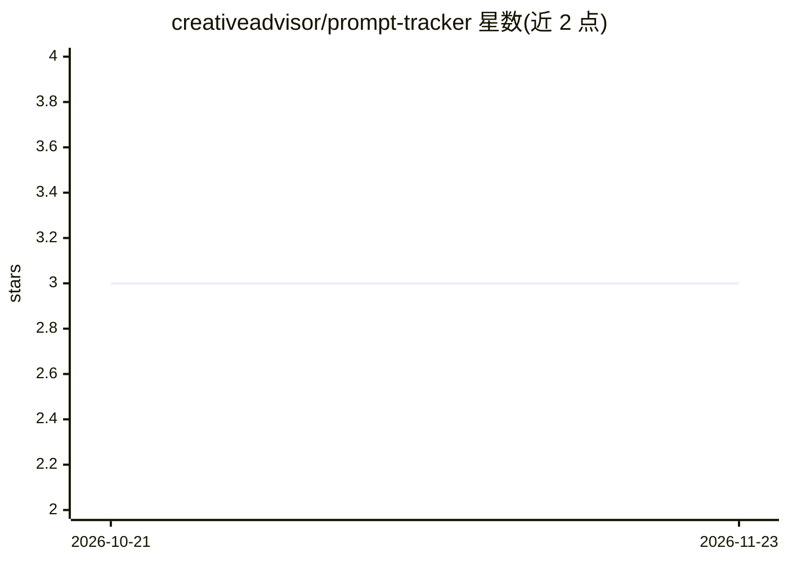

# creativeadvisor/prompt-tracker

⭐ 3 · TypeScript · MIT · 推送 2026-10-08 · [GitHub](https://github.com/creativeadvisor/prompt-tracker) · 个人维护

**自托管的品牌 AI 答案引擎可见性追踪应用**

自托管应用，运行在用户自己的 Supabase 项目上并自带 API key，无托管服务。用户录入人们会问 ChatGPT、Google AI Overview、Gemini、Claude 的问题，应用调用各引擎存储答案，再做两层分析：确定性的提及/位置/引用归属检测，以及可选的 LLM judge（结构化输出，逐句核对引文是否逐字）。提供可见率、声量份额、立场趋势等五个界面，支持定时运行、CSV 导出、与上次运行的 diff。无 key 时可用 mock 引擎与 mock judge 全流程运行。

## 筛选速览

| 维度 | 判定 | 备注 |
|---|---|---|
| AI 角色 | `ai-enhanced` | 去掉 AI 部分产品仍成立 |
| 许可风险 | `permissive` | MIT |
| 部署形态 | `None` |  |
| 模型依赖 | locked-api |  |
| 硬件要求 | — | 无带数字的原话,不猜 |
| 安装摩擦 | `low` | 无编译、无系统依赖或容器化 |
| 成熟度 | — | 结构信号不足 |

## 能力要点

- 六种引擎适配器（ChatGPT/Gemini/Claude/Google AI Overview/手动粘贴/Mock），缺失 key 时该引擎标记 unavailable
- 两层分析：确定性提及检测 + 可开关的 LLM judge，引文逐字校验
- 基于 pg_cron 的定时运行与每账号每日调用上限
- 按 rubric 版本存储分析结果，历史不因重算而改变

## 适用场景

- 持续追踪品牌在 AI 答案中的被提及率、位置与立场变化
- 查看引擎为品牌相关提示词引用了哪些域名及归属
- 对比品牌与竞争对手在 AI 答案中的呈现

## 场景标签

 · 领域:品牌监测/营销分析

## 证据(README 行号)

> L11: It is a small, self-hosted app. You run it on your own Supabase project with
> L27: (word-boundary mention detection, citation ownership, structure) and an LLM
> L233: Each brand has a *Sentiment analysis* switch in Settings; `JUDGE_ENABLED=false`

## 星数曲线

2026-10-21 3 → 2026-11-23 3（+0）

---
*卡片 v1 · prompt 1.4 · 生成 2026-11-22 · 置信度 mid · 依据 README sha `9f131574a450` · [字段定义](../../DATASET.md)*
