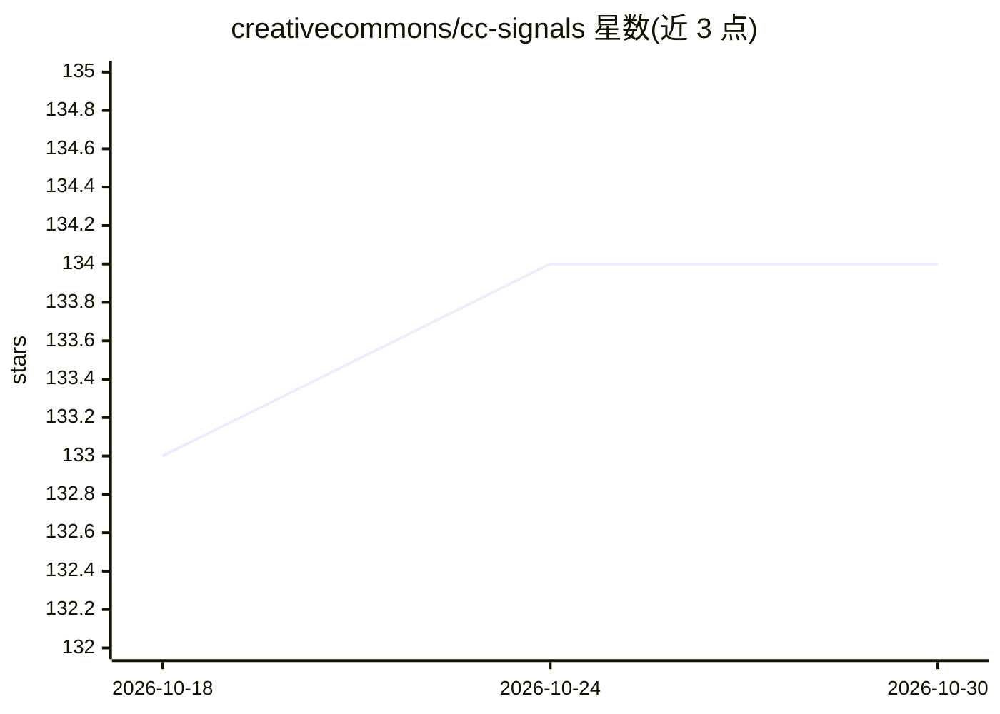

# creativecommons/cc-signals

⭐ 134 · CC-BY-4.0 · 推送 2025-12-04 · [GitHub](https://github.com/creativecommons/cc-signals) · [官网](https://creativecommons.org/ai-and-the-commons/cc-signals/) · 组织维护

**Creative Commons 提出的 AI 数据复用偏好信号规范草案**

CC signals 是 Creative Commons 发布的框架草案，供内容集合管理者（Declaring Party）声明 AI 开发者复用数据须满足的条件。草案提出四个信号元素组合：Credit、Direct Contribution、Ecosystem Contribution、Open，机器与人类均可读。机器用范畴基于 IETF 正在制定的 AI 偏好标准，通过 robots.txt 与 HTTP 头中的 content usage expression 表达。文档为公开征求意见的草案阶段，法律效力因司法辖区与申请方版权地位而异，具体实现细节尚未确定。

## 筛选速览

| 维度 | 判定 | 备注 |
|---|---|---|
| AI 角色 | `ai-ecosystem` | LLM/agent 周边工具 |
| 许可风险 | `viral` | CC-BY-4.0 |
| 部署形态 | `None` |  |
| 模型依赖 | — | README 未给出锁定关系 |
| 硬件要求 | — | 无带数字的原话,不猜 |
| 安装摩擦 | `low` | 无编译、无系统依赖或容器化 |
| 成熟度 | `idea` | |

## 能力要点

- 四个草案信号：Credit / Direct Contribution / Ecosystem Contribution / Open
- 基于 IETF AI 偏好标准，经 robots.txt 与 HTTP 头以 content usage expression 表达
- 覆盖 Automated Processing、AI Training、Generative AI Training 等标准机器使用类别
- 对完全选择退出的场景不适用，仅用于附带条款允许复用的情形

## 适用场景

- 内容库管理者声明 AI 训练数据复用的条款
- AI 开发者了解并遵守数据集合的机器复用偏好
- 研究机构跟踪 AI 数据偏好信号的标准演进

## 场景标签

 · 领域:数据治理/AI 政策规范

## 证据(README 行号)

> L30: Using CC signals, a steward of a large collection of content can express a set of criteria that AI developers must 
> L113: Our implementation proposal is focused on integration with existing but evolving web standards and protocols. The 

## 星数曲线

2026-10-18 133 → 2026-10-30 134（+1）

---
*卡片 v1 · prompt 1.4 · 生成 2026-10-22 · 置信度 high · 依据 README sha `ad0c21057b3c` · [字段定义](../../DATASET.md)*
