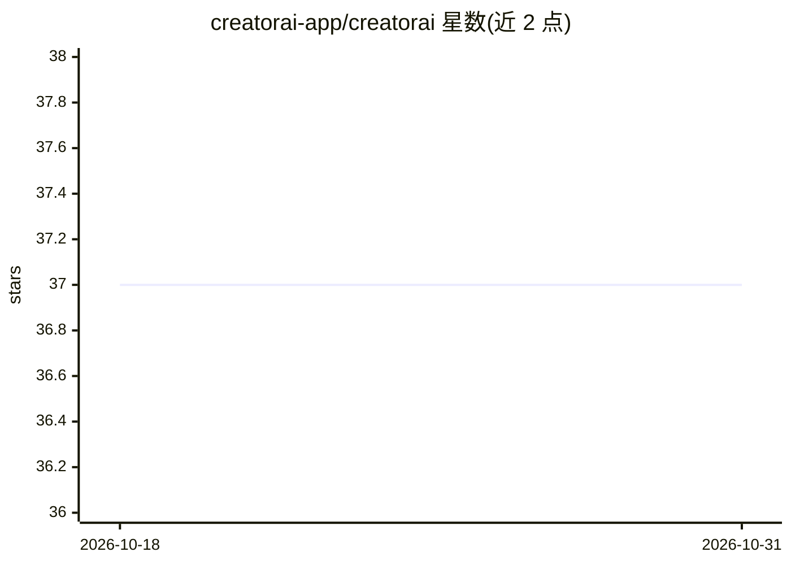

# creatorai-app/creatorai

⭐ 37 · TypeScript · MIT · 推送 2026-10-15 · [GitHub](https://github.com/creatorai-app/creatorai) · [官网](https://trycreatorai.com) · 组织维护

**面向 YouTuber 的个性化内容创作 Web 应用：学风格并生成脚本/字幕/配音/视频**

基于 Next.js + NestJS + Supabase 的全栈 Web 应用：用户连接 YouTube 频道并提供 3–5 个视频，系统经 Gemini on Vertex AI 训练学习其语气、词汇与结构，随后生成个性化脚本、选题、字幕、29 语种克隆配音的 AI 配音、文生视频与缩略图。长任务经 BullMQ+Redis 队列处理并以 SSE 流式反馈进度；内置积分计费、订阅、推荐与管理后台。自托管需配置 Supabase、Vertex AI、GCS、Redis 等多个外部服务。

## 筛选速览

| 维度 | 判定 | 备注 |
|---|---|---|
| AI 角色 | `ai-native` | 本体是模型或模型工具 |
| 许可风险 | `permissive` | MIT |
| 部署形态 | `self-host` | docker 或自建部署 |
| 模型依赖 | — | README 未给出锁定关系 |
| 硬件要求 | — | 无带数字的原话,不猜 |
| 安装摩擦 | `low` | 无编译、无系统依赖或容器化 |
| 成熟度 | — | 结构信号不足 |

## 能力要点

- 分析已有 YouTube 视频训练个人风格（语气/词汇/节奏）
- 生成脚本、选题、字幕、AI 配音（29 语种克隆声音）、文生视频、缩略图
- BullMQ+Redis 异步任务与 SSE 实时进度流
- 基于积分的计费与订阅体系（Lemon Squeezy）

## 适用场景

- 让 AI 按我的风格写视频脚本和选题
- 把视频配音成多语种并保留我的声音
- 自动生成带时间轴的字幕并导出 SRT/VTT

## 场景标签

`AI 写作` `语音合成` `视频生成` · 领域:内容生成

## 证据(README 行号)

> L3: > **AI that learns your style and helps you create content faster.** Creator AI analyzes your existing YouTube video
> L38: |AI|Gemini on Vertex AI — `gemini-3.6-flash` (text), `gemini-3.5-flash-lite`, `gemini-3.1-flash-image` (thumbnails)

## 星数曲线

2026-10-18 37 → 2026-10-31 37（+0）

---
*卡片 v1 · prompt 1.4 · 生成 2026-10-25 · 置信度 mid · 依据 README sha `3b4719c191e3` · [字段定义](../../DATASET.md)*
