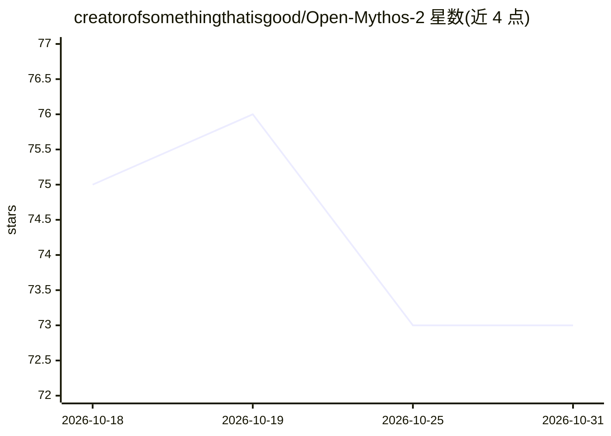

# creatorofsomethingthatisgood/Open-Mythos-2

⭐ 73 · Python · Apache-2.0 · 推送 2026-07-19 · [GitHub](https://github.com/creatorofsomethingthatisgood/Open-Mythos-2) · [官网](https://bold-lynx-68.fylo.live/) · 个人维护

**本地离线终端 AI 聊天工具：无 API key，含自学习与安全扫描**

运行于终端的完全本地离线 AI 聊天程序，基于 GGUF 模型（经 llama-cpp-python 推理，支持 Vulkan/Metal/CUDA 加速），无需 API key 与云依赖。提供多轮对话、Gradio 网页界面、会话/历史管理、技能市场、静态安全扫描与 AI 深度审计。RML 反馈学习机制根据用户评价（显式打分与隐式信号）自动修改系统提示词并调整 temperature/top_p 等生成参数。可选切换 OpenAI 兼容云 API（nvidia/openai/together/groq）。安装支持 git 源码、npm/pnpm、pipx、Homebrew、Docker 与离线捆绑包。

## 筛选速览

| 维度 | 判定 | 备注 |
|---|---|---|
| AI 角色 | `ai-native` | 本体是模型或模型工具 |
| 许可风险 | `permissive` | Apache-2.0 |
| 部署形态 | `self-host` | docker 或自建部署 |
| 模型依赖 | local-ok | 支持本地模型 |
| 硬件要求 | `cpu-ok` | |
| 安装摩擦 | `low` | 无编译、无系统依赖或容器化 |
| 成熟度 | — | 结构信号不足 |

## 能力要点

- 完全本地离线运行，GGUF 模型 + llama-cpp-python 推理（Vulkan/Metal/CUDA）
- RML 反馈学习：按用户评价自动编辑系统提示词并调整生成参数
- 静态安全扫描与 AI 深度审计、自动修复命令
- 提供 Gradio 网页 UI 与技能市场，支持离线捆绑包安装

## 适用场景

- 在无网络环境用终端进行本地 AI 对话
- 让 AI 助手随反馈逐步匹配我的偏好风格
- 对本地代码做静态安全扫描与 AI 审计

## 场景标签

`聊天机器人` `AI 助手` · 领域:对话与助手

## 证据(README 行号)

> L31: **Fully local, offline AI in your terminal. Zero API keys. Zero cloud. Zero limits.**
> L48: **OpenMythos-2** is a fully **local**, **offline** AI that lives and breathes inside your terminal. Inspired by the

## 星数曲线

2026-10-18 75 → 2026-10-31 73（-2）

---
*卡片 v1 · prompt 1.4 · 生成 2026-10-24 · 置信度 high · 依据 README sha `507fe50e6ab1` · [字段定义](../../DATASET.md)*
