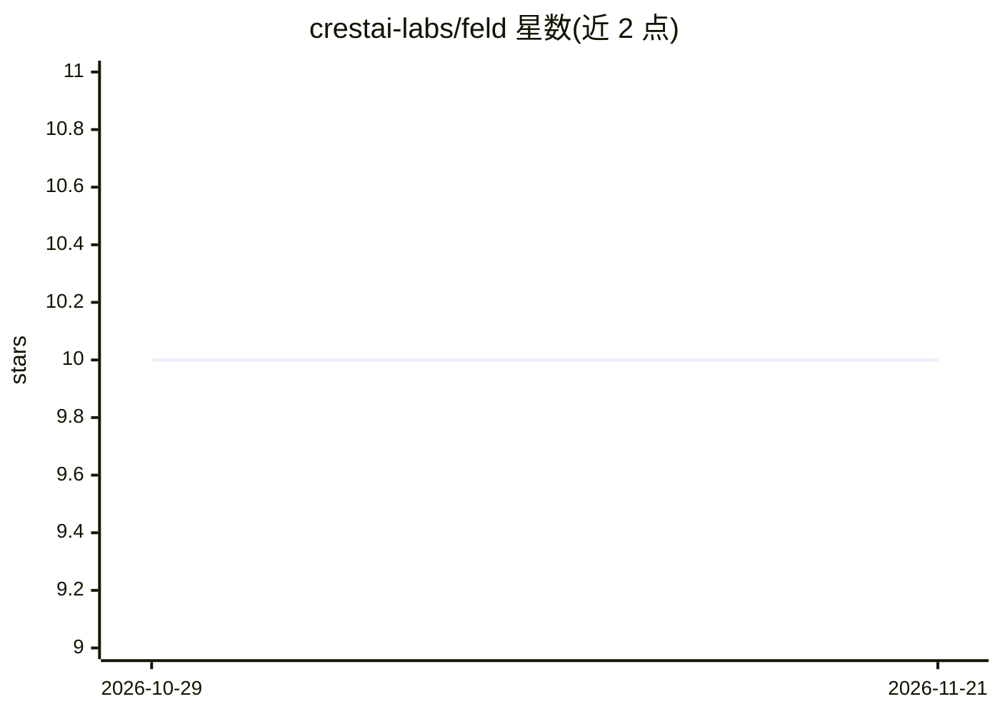

# crestai-labs/feld

⭐ 10 · Rust · Apache-2.0 · 推送 2026-11-08 · [GitHub](https://github.com/crestai-labs/feld) · 组织维护 · 中文 README

**为编码 agent 循环提供的控制平面：会话可见、可协调**

Feld 是一个与 harness 无关的 Agent Loop 控制平面，面向同时运行多个编码 agent 的开发者。它为 agent 和定时任务提供持久身份，在一条持久时间线上记录 Session 起止、Message 传递与定时触发事实；发给已停止 agent 的消息由其下一个 Session 读取。CLI 与 Web UI 通过守护进程在 tmux/herdr 中启停 Claude Code 或 Codex 会话并收集 transcript 与指标。策略仍留在用户自己的 harness 中。当前处于 0.x 实验期，CLI/API/存储可能不兼容变更。

## 筛选速览

| 维度 | 判定 | 备注 |
|---|---|---|
| AI 角色 | `ai-ecosystem` | LLM/agent 周边工具 |
| 许可风险 | `permissive` | Apache-2.0 |
| 部署形态 | `None` |  |
| 模型依赖 | — | README 未给出锁定关系 |
| 硬件要求 | — | 无带数字的原话,不猜 |
| 安装摩擦 | `low` | 无编译、无系统依赖或容器化 |
| 成熟度 | `idea` | |

## 能力要点

- 为 agent 与定时任务提供持久身份与持久时间线
- 支持 Claude Code 与 Codex 共用同一身份与消息模型
- 提供 Web UI 与 CLI 查看运行状态并接收消息投递
- 不含模型/提示词决策，策略保留在用户 harness 中

## 适用场景

- 将多个编码 agent 与定时任务编排成循环时追踪谁在运行
- 避免上一轮未结束就触发下一轮导致的重复执行
- 查看多个 agent 会话的时间线、指标与需要人介入的位置

## 场景标签

`编码 Agent` · 领域:编码与开发

## 证据(README 行号)

> L20: Feld is a harness-agnostic **Agent Loop Control Plane** for developers who run multiple coding agents in loops. It 
> L44: - **Not a harness, agent framework, or LLM SDK.** Feld does not decide the model, prompt, tools, or plan, nor which

## 星数曲线

2026-10-29 10 → 2026-11-21 10（+0）

---
*卡片 v1 · prompt 1.4 · 生成 2026-11-19 · 置信度 high · 依据 README sha `4fe150baec88` · [字段定义](../../DATASET.md)*
