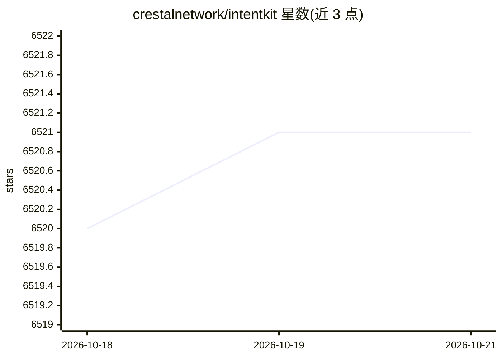

# crestalnetwork/intentkit

⭐ 6,521 · Python · MIT · 推送 2026-09-16 · [GitHub](https://github.com/crestalnetwork/intentkit) · [官网](https://intentcat.com/docs) · 组织维护

**自托管云原生 AI agent 集群：多 agent 协作管理框架**

开源、自托管的云端 agent 集群，管理一组可相互调用协作的 AI agent。定位与本地个人助手路线相对，强调云端运行、低本地资源占用；agent 设计上无法访问用户的秘密密钥；支持可选的 Web3/区块链集成、社交媒体平台接入，并提供可扩展的技能系统。部署方式包括自行部署、作为 Python 库导入扩展，以及通过内置 API 端点从外部应用调用 agent。MIT 许可，提供 Docker 徽标与文档、部署指南。

## 筛选速览

| 维度 | 判定 | 备注 |
|---|---|---|
| AI 角色 | `ai-ecosystem` | LLM/agent 周边工具 |
| 许可风险 | `permissive` | MIT |
| 部署形态 | `library` | 以包/库形式分发 |
| 模型依赖 | — | README 未给出锁定关系 |
| 硬件要求 | — | 无带数字的原话,不猜 |
| 安装摩擦 | `low` | 无编译、无系统依赖或容器化 |
| 成熟度 | — | 结构信号不足 |

## 能力要点

- 多 agent 相互调用与协作的集群管理
- agent 无法访问用户秘密密钥的安全设计
- 可选 Web3/区块链集成与社交媒体接入
- 可作为 Python 库使用或经 API 端点调用

## 适用场景

- 在云端自托管一组协作的 AI agent
- 把 agent 集群能力以 Python 库形式集成到现有项目
- 从外部应用通过 API 与部署的 agent 交互

## 场景标签

`Agent 框架` `多智能体` · 领域:Agent 开发

## 证据(README 行号)

> L12: IntentKit is an open-source, self-hosted cloud agent cluster that manages a collaborative team of AI agents for you
> L45: - **As a Python Library:** Import and extend IntentKit, or use it to add agent cluster capabilities to your existin

## 星数曲线

2026-10-18 6,520 → 2026-10-21 6,521（+1）

---
*卡片 v1 · prompt 1.4 · 生成 2026-10-20 · 置信度 high · 依据 README sha `27988997c20b` · [字段定义](../../DATASET.md)*
