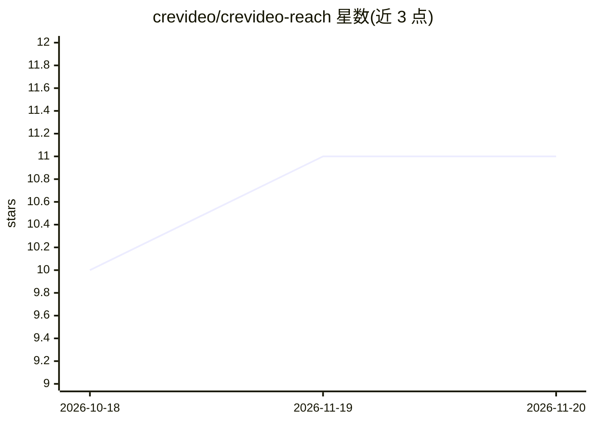

# crevideo/crevideo-reach

⭐ 11 · MIT · 推送 2026-11-02 · [GitHub](https://github.com/crevideo/crevideo-reach) · [官网](https://www.crevideo.com) · 组织维护 · 中文 README

**TikTok Shop 达人建联营销的 Claude 插件（9 技能 + 79 MCP 工具）**

将 Claude（Claude Code / Claude.ai web / OpenAI Codex）改造为 TikTok Shop 达人建联与营销助手的插件包：1 个基础技能 + 8 个业务场景技能（达人打分、合作分层、佣金合规检查、品牌安全扫描、建联文案起草、私信分诊、召回与清理、效果诊断），并通过 OAuth 连接 Crevideo Reach MCP 服务器（79 个工具），覆盖 Target Collaboration、DM 自动化、达人管理、邮件、店铺/订单/分析等操作面。另附 5 个定时任务模板、2 份 Project Instructions 与品牌知识包模板，需手动配置。定位为 Euka 与 Reacher 的 agent-native 替代。

## 筛选速览

| 维度 | 判定 | 备注 |
|---|---|---|
| AI 角色 | `ai-native` | 本体是模型或模型工具 |
| 许可风险 | `permissive` | MIT |
| 部署形态 | `None` |  |
| 模型依赖 | locked-api |  |
| 硬件要求 | — | 无带数字的原话,不猜 |
| 安装摩擦 | `low` | 无编译、无系统依赖或容器化 |
| 成熟度 | — | 结构信号不足 |

## 能力要点

- 9 个技能由自然语言业务提示触发（打分/起草/分诊等）
- MCP 服务器提供 79 个工具，OAuth 连接无需手动 API key
- 提供 5 个定时任务模板与 Monitor/Action 两份 Project Instructions
- 同一仓库同时维护 Claude Code 与 Codex 两种插件目录布局

## 适用场景

- 为 TikTok Shop 店铺批量筛选和分层达人并起草建联私信
- 自动化管理 DM/邮件跟进与达人召回、清理不活跃达人
- 跨境多市场运营中按区域管理授权店铺与佣金合规检查

## 场景标签

 · 领域:电商/营销自动化

## 证据(README 行号)

> L3: > **Crevideo Reach** — turn Claude (Cowork / Claude Code) into your TikTok Shop affiliate outreach & marketing assis
> L7: > 1 base skill + 8 business-scenario skills + Crevideo Reach MCP (79 tools) + 5 scheduled-task templates + 2 Project
> L34: 1. **9 skills auto-load** — triggered by natural business prompts ("score these creators", "draft an outreach messa

## 星数曲线

2026-10-18 10 → 2026-11-20 11（+1）

---
*卡片 v1 · prompt 1.4 · 生成 2026-11-19 · 置信度 high · 依据 README sha `1206155cd68f` · [字段定义](../../DATASET.md)*
