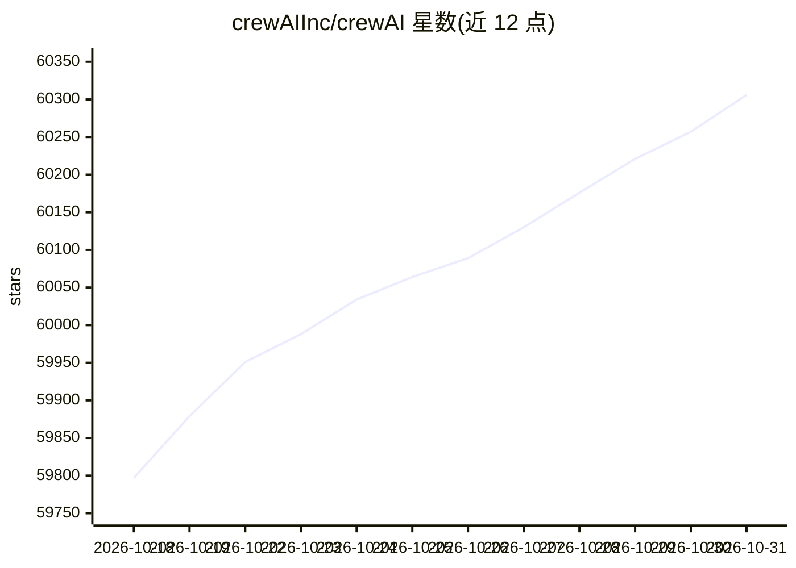

# crewAIInc/crewAI

⭐ 60,306 · Python · MIT · 推送 2026-10-30 · [GitHub](https://github.com/crewAIInc/crewAI) · [官网](https://crewai.com) · 组织维护

**面向开发者的多 Agent 协作编排 Python 框架**

开源 Python 框架，通过 Crews（基于角色的自主协作 Agent 团队）与 Flows（事件驱动、精细控制的确定性工作流）两种抽象构建多 Agent 自动化。提供 CLI（crewai create/install/run）以 JSON-first 项目结构脚手架化项目，支持工具、记忆、知识、结构化输出、checkpointing 与 MCP/A2A；要求 Python >=3.10 且 <3.14，依赖 uv 管理。另有面向企业的 AMP Suite 商业控制面提供托管部署、可观测性与支持。

## 筛选速览

| 维度 | 判定 | 备注 |
|---|---|---|
| AI 角色 | `ai-native` | 本体是模型或模型工具 |
| 许可风险 | `dual` | MIT |
| 部署形态 | `library` | 以包/库形式分发 |
| 模型依赖 | — | README 未给出锁定关系 |
| 硬件要求 | — | 无带数字的原话,不猜 |
| 安装摩擦 | `low` | 无编译、无系统依赖或容器化 |
| 成熟度 | — | 结构信号不足 |

## 动量与使用信号

- 维护:`active` — 距上次 push 1.3 天,年发版 100,345 位贡献者
- 涨星:近 1 天 **+38**(自 20261016 起算)
- 安装:npm 包 `skills` 月下载 23,786,800
- 平台:— · 协议:OPENAI-API / MCP / OLLAMA

## 能力要点

- Crews（自主协作）与 Flows（事件驱动控制）双模型组合
- CLI 一键创建项目并按 JSON 定义运行（crewai create/run）
- 支持工具、记忆、知识、结构化输出、checkpointing 与 MCP/A2A
- 提供 Claude Code/Cursor 等 AI 编码 agent 的官方 skills 安装

## 适用场景

- 构建多 Agent 角色分工协作的自动化流水线
- 需要精细流程控制与状态管理的事件驱动工作流
- 将原型级 agent 应用推进到生产级部署
- 让 AI 编码助手按官方最佳实践生成 CrewAI 项目

## 场景标签

`Agent 框架` `多智能体` · 领域:Agent 开发

## 证据(README 行号)

> L49: > CrewAI is an open-source Python framework with high-level abstractions and low-level APIs for building production
> L52: - **CrewAI Crews**: Optimize for autonomy and collaborative intelligence with role-based AI agents.
> L53: - **CrewAI Flows**: Build event-driven automations that combine precise workflow control, single LLM calls, and nat

## 星数曲线

2026-10-18 59,797 → 2026-10-31 60,306（+509）

---
*卡片 v1 · prompt 1.4 · 生成 2026-10-18 · 置信度 mid · 依据 README sha `4c734e241611` · [字段定义](../../DATASET.md)*
