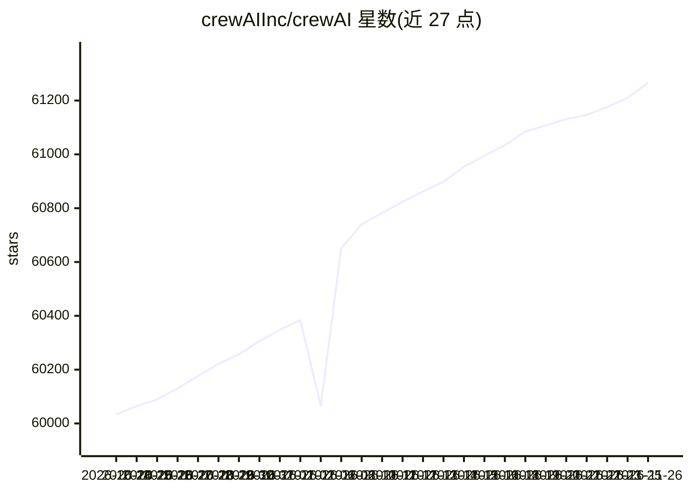

# crewAIInc/crewAI

⭐ 61,266 · Python · MIT · 推送 2026-11-25 · [GitHub](https://github.com/crewAIInc/crewAI) · [官网](https://crewai.com) · 组织维护

**给开发者的多智能体编排框架，用 Crews/Flows 构建自动化**

开源 Python 框架，提供两种构建方式：Crews 通过角色化智能体实现自主协作与任务委派，Flows 提供事件驱动、带状态管理与条件分支的精确工作流控制，两者可组合使用。配套 CLI 可创建项目、安装依赖并运行（crewai create/install/run），项目以 JSON 定义智能体与任务，支持自定义工具、知识文件、结构化输出、人审环节、checkpointing 与 MCP/A2A。要求 Python >=3.10 且 <3.14，依赖 uv 管理环境；另有面向企业的商业控制面 AMP Suite。

## 筛选速览

| 维度 | 判定 | 备注 |
|---|---|---|
| AI 角色 | `ai-ecosystem` | LLM/agent 周边工具 |
| 许可风险 | `permissive` | MIT |
| 部署形态 | `library` | 以包/库形式分发 |
| 模型依赖 | — | README 未给出锁定关系 |
| 硬件要求 | — | 无带数字的原话,不猜 |
| 安装摩擦 | `low` | 无编译、无系统依赖或容器化 |
| 成熟度 | — | 结构信号不足 |

## 动量与使用信号

- 维护:`active` — 距上次 push 1.3 天,年发版 100,345 位贡献者
- 涨星:近 1 天 **+38**(自 20261016 起算)
- 安装:npm 包 `skills` 月下载 23,786,800
- 平台:— · 协议:OPENAI-API / MCP / OLLAMA

## 能力要点

- Crews（自主协作）与 Flows（事件驱动控制）两种编排模式
- CLI 全流程：create/install/run，项目以 agents/*.jsonc 与 crew.jsonc 定义
- 支持 tools、memory、knowledge、checkpointing、异步执行与 MCP/A2A
- 提供面向 AI 编码助手的官方 skills（Claude Code/Cursor 等）

## 适用场景

- 编排多个角色化智能体协作完成研究与报告生成任务
- 构建需要状态管理与条件分支的生产级事件驱动工作流
- 为团队搭建可部署、可观测的 agentic 自动化应用

## 场景标签

`Agent 框架` `多智能体` · 领域:Agent 开发

## 证据(README 行号)

> L49: > CrewAI is an open-source Python framework with high-level abstractions and low-level APIs for building production
> L52: - **CrewAI Crews**: Optimize for autonomy and collaborative intelligence with role-based AI agents.
> L53: - **CrewAI Flows**: Build event-driven automations that combine precise workflow control, single LLM calls, and nat

## 星数曲线

2026-10-24 60,034 → 2026-11-26 61,266（+1,232）

---
*卡片 v1 · prompt 1.4 · 生成 2026-11-22 · 置信度 mid · 依据 README sha `cfd991b89b23` · [字段定义](../../DATASET.md)*
