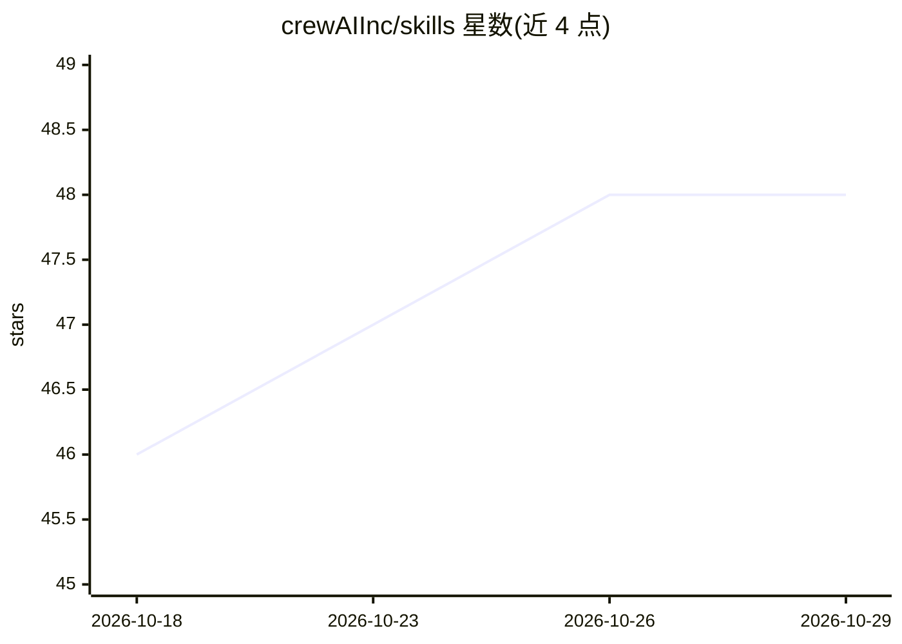

# crewAIInc/skills

⭐ 48 · Python · MIT · 推送 2026-10-06 · [GitHub](https://github.com/crewAIInc/skills) · 组织维护

**面向 AI 编程代理的 CrewAI 开发技能集（10 项，Agent Skills 格式）**

CrewAI 官方维护的技能仓库，收录 10 个遵循 Agent Skills 格式的技能，教 AI 编程代理按最佳实践使用 CrewAI：项目脚手架与架构选择、Agent/Task 设计、Flows 构建、MCP 与工具接入、离线 pytest 测试、部署到 CrewAI AMP 及 HTTP 调用已部署的 crew。每项技能标注验证过的 crewai 版本，版本不符时提示用 ask-docs 技能复核。以 Claude Code 插件市场方式安装，每技能含 SKILL.md 与 references/ 参考资料。

## 筛选速览

| 维度 | 判定 | 备注 |
|---|---|---|
| AI 角色 | `ai-knowledge` | 知识聚合/清单类 |
| 许可风险 | `permissive` | MIT |
| 部署形态 | `None` |  |
| 模型依赖 | — | README 未给出锁定关系 |
| 硬件要求 | — | 无带数字的原话,不猜 |
| 安装摩擦 | `low` | 无编译、无系统依赖或容器化 |
| 成熟度 | — | 结构信号不足 |

## 能力要点

- 10 个技能覆盖从脚手架、设计、Flow、MCP 到测试与部署的 CrewAI 开发全流程
- 每个技能标注验证时的 crewai 发布版本，版本不匹配时触发复核
- 内置 stub BaseLLM 实现无 API key 的离线 pytest 测试技能
- 技能按请求描述自动加载，随附各技能触发示例提示词

## 适用场景

- 在 Claude Code 中让编程代理帮我搭建并调试 CrewAI 项目
- 排查 crewai 1.x 与记忆中 0.x API 的版本不匹配错误
- 离线测试 crew 与 flow 并部署到 CrewAI AMP
- 编写调用已部署 crew 的 HTTP 客户端

## 场景标签

`Agent 框架` · 领域:Agent 开发

## 证据(README 行号)

> L3: A collection of skills for AI coding agents that teach best practices for building with CrewAI. Skills follow the Ag
> L145: Each skill contains:

## 星数曲线

2026-10-18 46 → 2026-10-29 48（+2）

---
*卡片 v1 · prompt 1.4 · 生成 2026-10-25 · 置信度 high · 依据 README sha `ac3eaad5dc78` · [字段定义](../../DATASET.md)*
