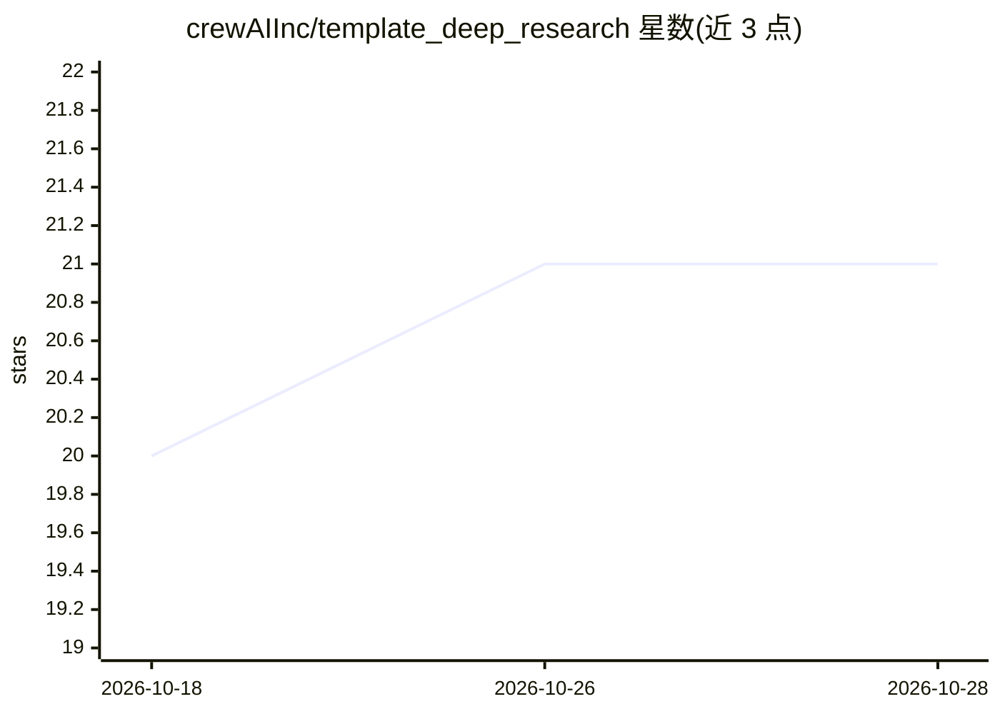

# crewAIInc/template_deep_research

⭐ 21 · Python · 推送 2026-03-19 · [GitHub](https://github.com/crewAIInc/template_deep_research) · 组织维护

**开发者：CrewAI Flow 构建的对话式深度研究模板**

基于 CrewAI Flow 的对话式深度研究系统模板：用户消息经单次 LLM 调用分类为闲聊或需检索的问题；检索路径生成 3–5 个搜索查询，交给配备 Firecrawl 搜索与抓取工具的内联 Agent，产出带编号引用的回答。状态通过 @persist() 跨次保存，支持多轮细化主题。面向使用 CrewAI 的开发者：本地用 crewai run 运行，附 Streamlit 聊天前端连接 CrewAI AMP 部署实例，前端可经 git subtree 部署到 Heroku。需配置 OPENAI_API_KEY 与 FIRECRAWL_API_KEY。

## 筛选速览

| 维度 | 判定 | 备注 |
|---|---|---|
| AI 角色 | `ai-native` | 本体是模型或模型工具 |
| 许可风险 | `none` | — |
| 部署形态 | `None` |  |
| 模型依赖 | — | README 未给出锁定关系 |
| 硬件要求 | — | 无带数字的原话,不猜 |
| 安装摩擦 | `low` | 无编译、无系统依赖或容器化 |
| 成熟度 | — | 结构信号不足 |

## 能力要点

- 单次路由 LLM 调用同时完成意图分类与响应生成
- 内联 Agent 配 Firecrawl 搜索/抓取工具产出带引用回答
- @persist() 状态持久化支持多轮主题细化
- 附 Streamlit 聊天前端并支持 Heroku 部署

## 适用场景

- 搭建带引用的对话式深度研究助手
- 学习 CrewAI Flow 的路由/监听/持久化模式
- 作为 CrewAI AMP 部署与前端集成的起点模板

## 场景标签

`科研工具` · 领域:学习与行业

## 证据(README 行号)

> L3: A conversational deep-research system built with CrewAI Flow. It routes between casual chat and web research — when 
> L14: 1. **You send a message** — the router classifies your intent in a single `gpt-4.1-mini` call
> L16: 3. **Search** — anything factual triggers 3–5 search queries, handed to an inline Agent with Firecrawl tools

## 星数曲线

2026-10-18 20 → 2026-10-28 21（+1）

---
*卡片 v1 · prompt 1.4 · 生成 2026-10-28 · 置信度 high · 依据 README sha `d5333009cc11` · [字段定义](../../DATASET.md)*
