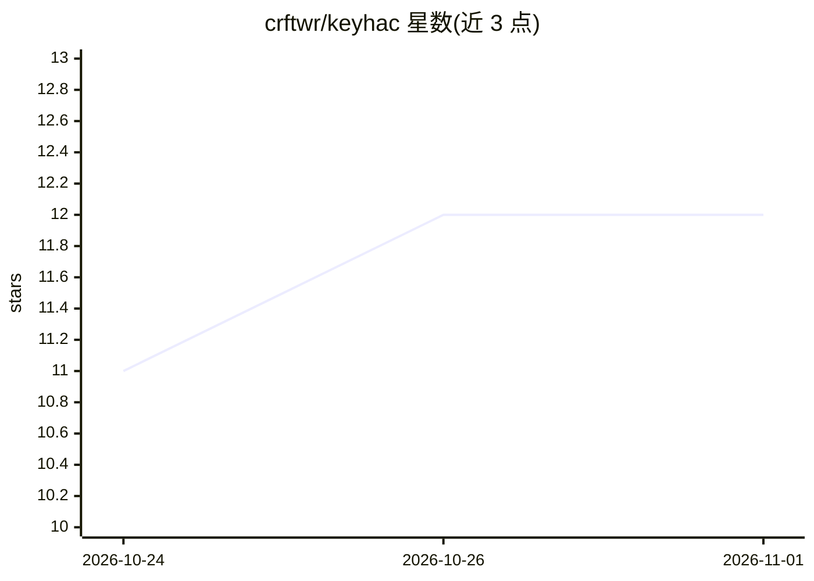

# crftwr/keyhac

⭐ 12 · Python · MIT · 推送 2026-10-31 · [GitHub](https://github.com/crftwr/keyhac) · [官网](https://crftwr.github.io/keyhac/) · 组织维护

**Python 脚本化键盘自定义工具：改键并可由 AI 代写自动化**

面向 Windows/macOS 的键盘自定义工具：安装系统级键盘钩子，通过 ~/.keyhac/config.py 一个 Python 文件实现改键、按键绑定 Python 函数、按应用/焦点路径区分按键表、用户自定义修饰键、剪贴板历史、窗口控制与键盘宏。AI 集成为可选功能：连接 Claude Desktop 或任意 MCP 客户端到本地端点，AI 可读取无障碍树、编写并测试 Action，之后 Action 纯 Python 离线运行。端点默认关闭，仅监听 loopback，令牌保护，一小时后自动关闭。

## 筛选速览

| 维度 | 判定 | 备注 |
|---|---|---|
| AI 角色 | `ai-enhanced` | 去掉 AI 部分产品仍成立 |
| 许可风险 | `permissive` | MIT |
| 部署形态 | `desktop` | 安装包/桌面程序 |
| 模型依赖 | — | README 未给出锁定关系 |
| 硬件要求 | — | 无带数字的原话,不猜 |
| 安装摩擦 | `low` | 无编译、无系统依赖或容器化 |
| 成熟度 | — | 结构信号不足 |

## 能力要点

- 单个 config.py 在 Windows/macOS 通用运行
- AI 助手经 MCP 端点读取无障碍树并生成、调试 Action，运行时无 AI 参与
- AI 端点默认关闭，仅监听 loopback 并有启动时令牌保护
- 按应用名/窗口标题/无障碍焦点路径精细区分按键表

## 适用场景

- 跨平台统一改键并把按键绑定到 Python 函数
- 让 AI 助手针对无 API 的应用编写键盘自动化脚本
- 管理剪贴板历史、窗口平铺与多键序列操作

## 场景标签

`GUI 自动化` · 领域:效率与自动化

## 证据(README 行号)

> L12: It can also write the harder scripts for you. Connect an AI assistant and it reads the
> L58: Keyhac can be driven by an AI assistant while you *write* your automation, and by
> L75: From then on it runs in milliseconds, offline, with no tokens and no model — the AI was

## 星数曲线

2026-10-24 11 → 2026-11-01 12（+1）

---
*卡片 v1 · prompt 1.4 · 生成 2026-11-01 · 置信度 high · 依据 README sha `f8fdf99cb5bf` · [字段定义](../../DATASET.md)*
