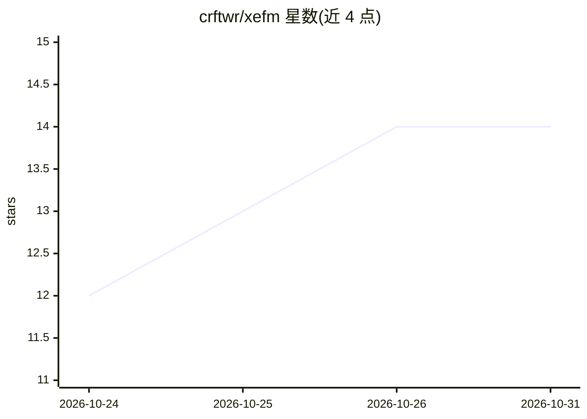

# crftwr/xefm

⭐ 14 · Python · NOASSERTION · 推送 2026-10-28 · [GitHub](https://github.com/crftwr/xefm) · [官网](https://crftwr.github.io/xefm/) · 个人维护

**键盘驱动的双栏文件管理器，桌面端与终端端皆可运行**

XeFM 是跨平台双栏文件管理器：Windows/macOS 提供原生桌面应用（Microsoft Store、winget、dmg、Homebrew cask），Windows/macOS/Linux 提供终端 TUI 应用（PyPI、Homebrew，需 Python 3.10+）。SSH、S3、SMB/WebDAV 与 ZIP/TAR 等归档可作为虚拟目录直接浏览；内置语法高亮文本、图像、Markdown、JSON、CSV 查看器，目录比较与同步、相似文件查找、OS 索引搜索、Migego 日文检索。功能可通过 Python 扩展包定制，并提供 XeFM skill 让 AI coding agent 编写扩展与修改配置。

## 筛选速览

| 维度 | 判定 | 备注 |
|---|---|---|
| AI 角色 | `ai-enhanced` | 去掉 AI 部分产品仍成立 |
| 许可风险 | `none` | NOASSERTION |
| 部署形态 | `desktop` | 安装包/桌面程序 |
| 模型依赖 | — | README 未给出锁定关系 |
| 硬件要求 | — | 无带数字的原话,不猜 |
| 安装摩擦 | `low` | 无编译、无系统依赖或容器化 |
| 成熟度 | — | 结构信号不足 |

## 能力要点

- 桌面应用（Windows/macOS）与终端 TUI（含 Linux）双形态，共享 ~/.xefm/ 设置
- SSH/S3/SMB/WebDAV 与归档以虚拟目录形式直接浏览
- 四种键位预设（AFX/Orthodox/OS 原生/Vim）与命令面板
- 提供 XeFM skill 供 AI coding agent 编写扩展、编辑配置

## 适用场景

- 用键盘高效完成双栏文件操作与跨窗格传输
- 直接浏览远程 SSH/S3 目录和压缩包内文件，无需解压
- 让 AI agent 帮我写扩展或改配置
- 目录比较、镜像同步与相似文件（重编码媒体）查找

## 场景标签

 · 领域:系统工具/文件管理

## 证据(README 行号)

> L5: XeFM — short for *Xenolith File Manager* — is a keyboard-driven dual-pane file manager that runs as a native desktop
> L45: - **Extensions** - Install packages that add actions, themes, filters, syntax highlighting and more — browse the li
> L177: - **The XeFM Skill for AI Agents** - Let an AI coding agent edit your configuration and write extensions

## 星数曲线

2026-10-24 12 → 2026-10-31 14（+2）

---
*卡片 v1 · prompt 1.4 · 生成 2026-10-31 · 置信度 high · 依据 README sha `18710a3ac19a` · [字段定义](../../DATASET.md)*
