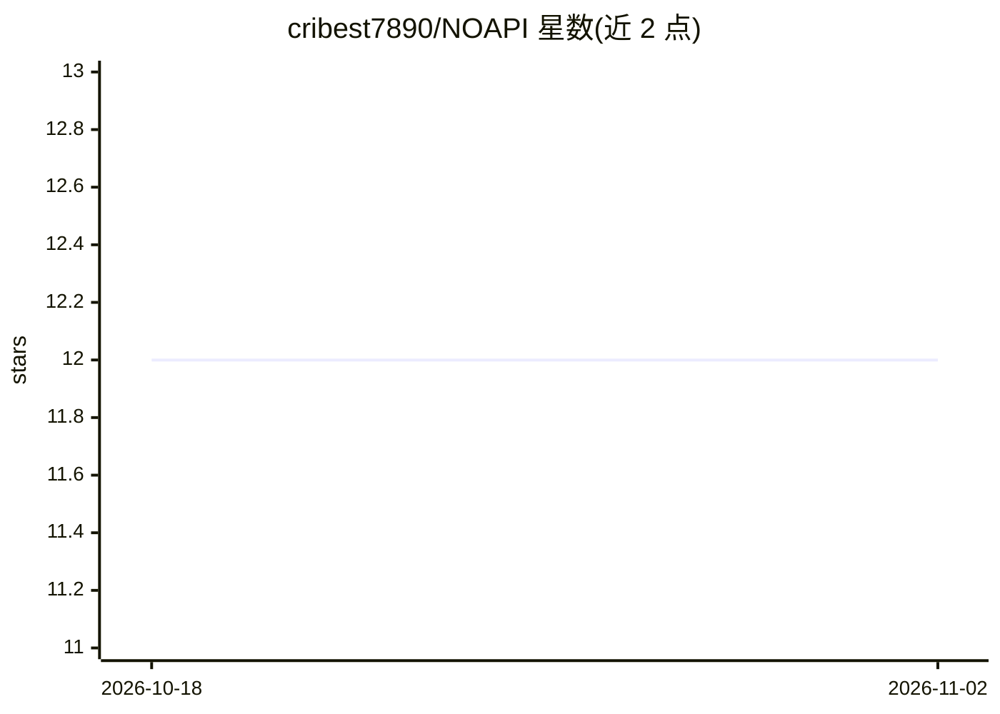

# cribest7890/NOAPI

⭐ 12 · JavaScript · MIT · 推送 2026-10-11 · [GitHub](https://github.com/cribest7890/NOAPI) · 个人维护

**让 OpenCode 通过浏览器扩展复用网页版 ChatGPT/Claude 等模型**

面向 OpenCode 用户的本地桥接工具：一个 Manifest V3 浏览器扩展在已登录的聊天网页（ChatGPT、Claude、Gemini、DeepSeek、Perplexity、Grok、Mistral）中自动输入提示词并捕获回答，本地 Node.js 桥（127.0.0.1:8787）以 OpenAI 兼容接口与 MCP 两种方式供 OpenCode 调用，无需 API key。通过在提示中注入文本协议让网页模型执行工具调用（bash/read/write 等）。零依赖、仅本地运行；依赖页面 CSS 选择器，站点改版即失效，且可能违反站点服务条款。

## 筛选速览

| 维度 | 判定 | 备注 |
|---|---|---|
| AI 角色 | `ai-ecosystem` | LLM/agent 周边工具 |
| 许可风险 | `permissive` | MIT |
| 部署形态 | `library` | 以包/库形式分发 |
| 模型依赖 | locked-api |  |
| 硬件要求 | — | 无带数字的原话,不猜 |
| 安装摩擦 | `low` | 无编译、无系统依赖或容器化 |
| 成熟度 | — | 结构信号不足 |

## 能力要点

- 浏览器扩展在已登录网页中自动输入提示并捕获回答，无需 API key
- 以 OpenAI 兼容端点与 MCP（stdio）两种方式接入 OpenCode
- 文本协议（TOOL_CALL 围栏块）实现网页模型的工具调用
- 纯 Node.js 18+、零依赖、仅监听 127.0.0.1

## 适用场景

- 已有聊天订阅但不想另付 API 费用的开发者，在 OpenCode 里使用网页版模型
- 让网页版模型驱动 OpenCode 的文件编辑与 shell 命令等工具
- 通过 MCP 工具从任意项目文件夹调用网页模型

## 场景标签

`模型网关` · 领域:Agent 开发

## 证据(README 行号)

> L25: API access costs money, and a lot of us already pay for a chat subscription that we barely squeeze the value out of
> L138:     A["OpenCode"] -- "OpenAI-style request POST /v1/chat/completions" --> B["Local bridge 127.0.0.1:8787"]

## 星数曲线

2026-10-18 12 → 2026-11-02 12（+0）

---
*卡片 v1 · prompt 1.4 · 生成 2026-11-01 · 置信度 high · 依据 README sha `dde81149bb4d` · [字段定义](../../DATASET.md)*
